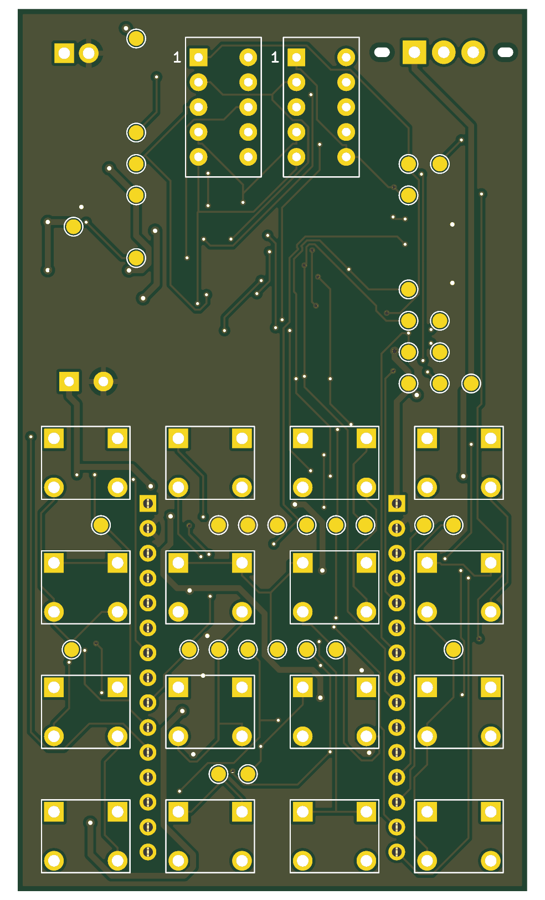
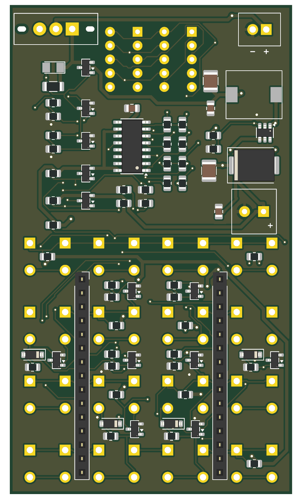

# Quiz Remote

Bộ bấm trả lời cầm tay dùng ESP32: 16 phím, hai LED 7 thanh, chạy bằng 2 pin AAA. Khi không bấm, toàn bộ mạch bị cắt nguồn; chính phím bấm đánh thức mạch, ESP32 tự giữ nguồn trong lúc làm việc rồi tự tắt.

| Mặt trước | Mặt sau |
|---|---|
|  |  |

## Trạng thái

Thiết kế đã qua kiểm tra trên máy tính, **chưa lắp và đo trên mạch thật**.

| Kiểm tra | Kết quả |
|---|---|
| ERC schematic | 0 lỗi |
| DRC mạch in, có đối chiếu schematic | 0 vi phạm, 0 dây chưa nối |
| Mô phỏng mạch đánh thức và tự giữ nguồn | Đạt với pin 3,0 V và 2,4 V |

## Thông số chính

- Mạch in 52 × 90 mm, 2 lớp; phím và LED ở mặt trước, linh kiện còn lại ở mặt sau.
- Module ESP32 NodeMCU LuaNode32 30 chân, cắm trên đế, rút ra để nạp chương trình.
- Nguồn 3,37 V từ mạch tăng áp MT3608; hộp pin 2×AAA nằm ngoài board, nối dây vào đầu JBAT.
- Linh kiện mua được tại ThegioiIC và LinhKienX, tổng khoảng 315.000 đ.

## Cấu trúc thư mục

| Đường dẫn | Nội dung |
|---|---|
| `quiz_remote_compact/` | Dự án KiCad 10: schematic (trang gốc và M1–M6), mạch in, thư viện ký hiệu và footprint |
| `quiz_remote_compact/route/` | File đi dây (DSN/SES), báo cáo DRC, ảnh render |
| `docs/tai-lieu-thiet-ke-phan-cung.md` | Tài liệu thiết kế: nguyên lý, tính toán, bảng chân, BOM kèm link mua, kết quả kiểm tra |
| `tools/sim_wake_hold.py` | Mô phỏng SPICE mạch đánh thức và tự giữ nguồn |
| `tools/wokwi_sim/` | Chương trình mẫu và sơ đồ để chạy trên Wokwi |
| `tools/build_compact_pcb.py` | Script dựng lại mạch in từ schematic |

## Cách dùng

Cần KiCad 10.

**Xem và sửa thiết kế:** mở `quiz_remote_compact/quiz_remote.kicad_pro` bằng KiCad.

**Kiểm tra lại:**

```sh
kicad-cli sch erc quiz_remote_compact/quiz_remote.kicad_sch
kicad-cli pcb drc --schematic-parity quiz_remote_compact/quiz_remote.kicad_pcb
```

**Mô phỏng phần nguồn** (dùng thư viện ngspice đi kèm KiCad):

```sh
python3 tools/sim_wake_hold.py
```

**Mô phỏng chương trình:** tạo dự án ESP32 trên [wokwi.com](https://wokwi.com), dán `tools/wokwi_sim/wokwi_sim.ino` vào `sketch.ino` và `tools/wokwi_sim/diagram.json` vào `diagram.json`, rồi bấm chạy. Khi nạp vào board thật, đổi `#define WOKWI 1` thành `0`.

**Dựng lại mạch in từ schematic:**

```sh
python3 tools/build_compact_pcb.py place
FREEROUTING_DIR=/duong/dan/freerouting python3 tools/build_compact_pcb.py route
python3 tools/build_compact_pcb.py finish
```

Bước `route` cần Freerouting 2.4.1 (file `freerouting-*.jar` và thư mục `jre25/`), không kèm trong repo. Freerouting cho kết quả khác nhau giữa các lần chạy, nên chạy lại DRC sau khi dựng.

## Trước khi đặt mạch

- Đo module ESP32 thật: board giả định hai hàng chân cách nhau 25,4 mm.
- Board chưa có lỗ bắt vít và chưa có chữ in tên linh kiện.
- Dòng nghỉ, gợn nguồn khi phát sóng và thời lượng pin chưa được đo.

Chi tiết ở mục 8 của [tài liệu thiết kế](docs/tai-lieu-thiet-ke-phan-cung.md).

## Giấy phép

MIT, xem [LICENSE](LICENSE).
