<div align="center">

# Quiz Remote · ClassPulse

**A wireless classroom quiz system: battery-powered ESP32 answer pads, an MQTT broker and a live teacher dashboard.**


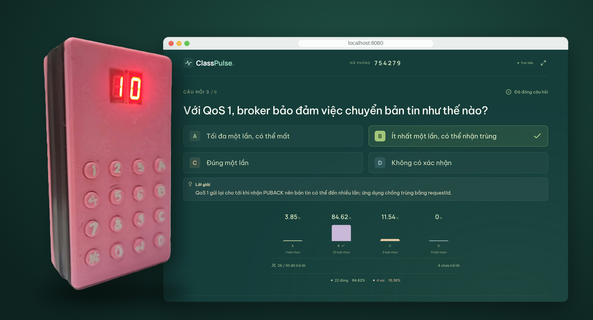

</div>

---

## Overview

Every student holds a small pad with 16 keys and two 7-segment digits. The teacher opens a session on a laptop, students type the 6-digit room code, and answers arrive on the projector within a fraction of a second. The whole system runs on the classroom Wi-Fi or a phone hotspot — no Internet connection is required.

| | |
|---|---|
| **Zero standby current** | A key press switches the board on; the ESP32 holds its own power and cuts it completely when done |
| **Reliable delivery** | MQTT QoS 1, an application-level ACK, retries and server-side de-duplication — no answer is lost or counted twice |
| **Network setup without reflashing** | Hold `0` for 3 s and the pad opens a captive-portal Wi-Fi setup page for any phone |
| **Live results** | Answer counts and the A–D distribution update in real time; correct answers stay hidden until the question closes |
| **Item analysis** | Difficulty, discrimination index, distractor effectiveness and KR-20 reliability after every session |
| **Question import** | Word, Excel, PDF and TXT, with optional AI help to write and review questions |

## The device

<table>
<tr>
<td align="center" width="28%">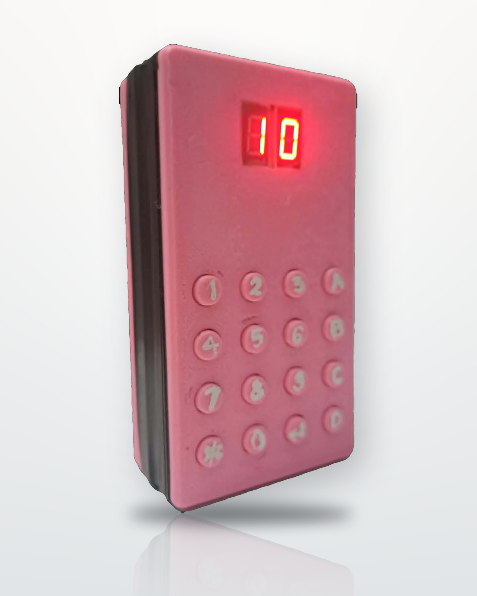</td>
<td align="center" width="44%">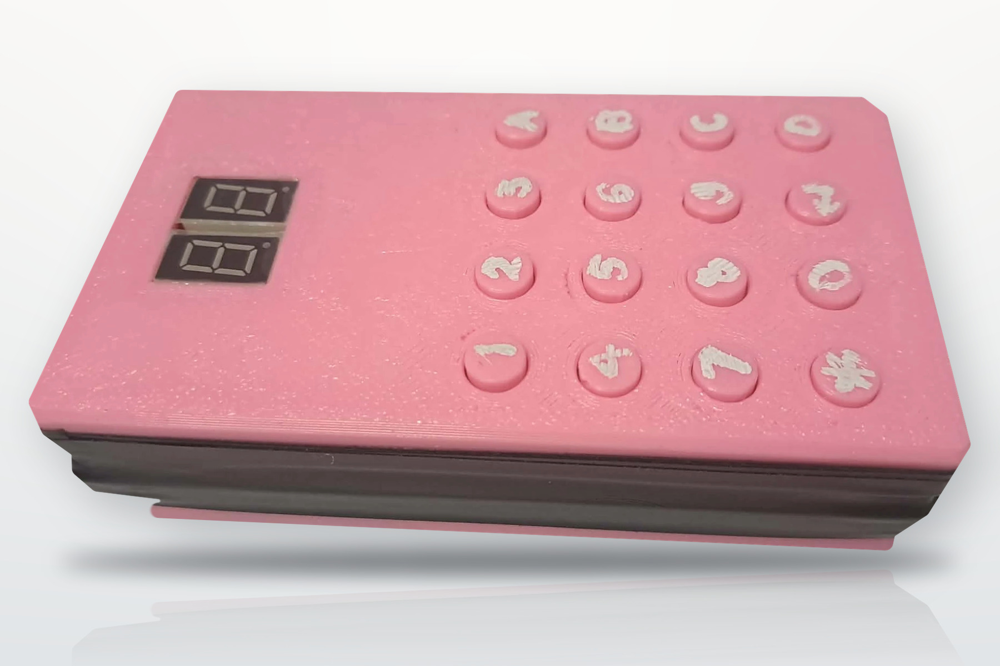</td>
<td align="center" width="28%">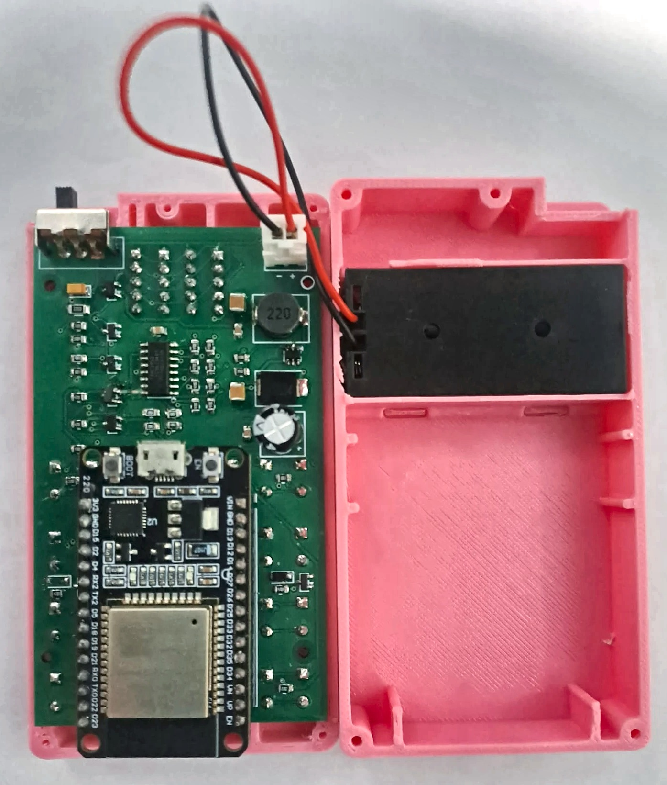</td>
</tr>
<tr>
<td align="center"><sub>Showing a final score of 10</sub></td>
<td align="center"><sub>3D-printed enclosure, 16 keys, two 7-segment digits</sub></td>
<td align="center"><sub>Inside: the PCB and the 2 × AAA holder</sub></td>
</tr>
</table>

## The teacher app

<table>
<tr>
<td width="50%">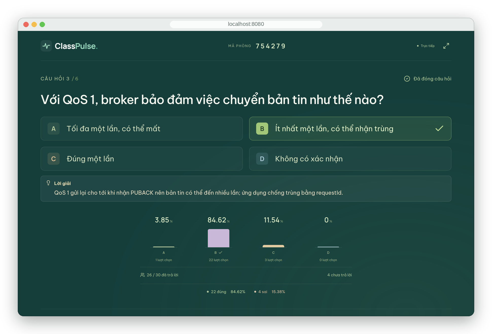</td>
<td width="50%">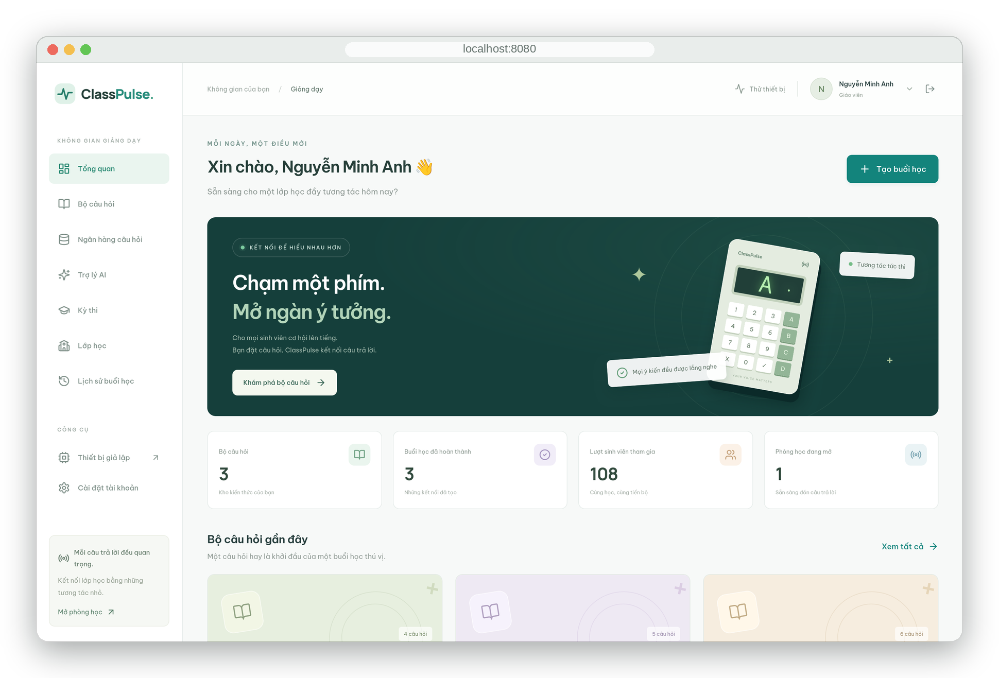</td>
</tr>
<tr>
<td align="center"><sub>Presentation view after a question closes: correct answer, explanation and the A–D chart</sub></td>
<td align="center"><sub>Dashboard: question sets, AI assistant, exams, classes and session history</sub></td>
</tr>
<tr>
<td width="50%">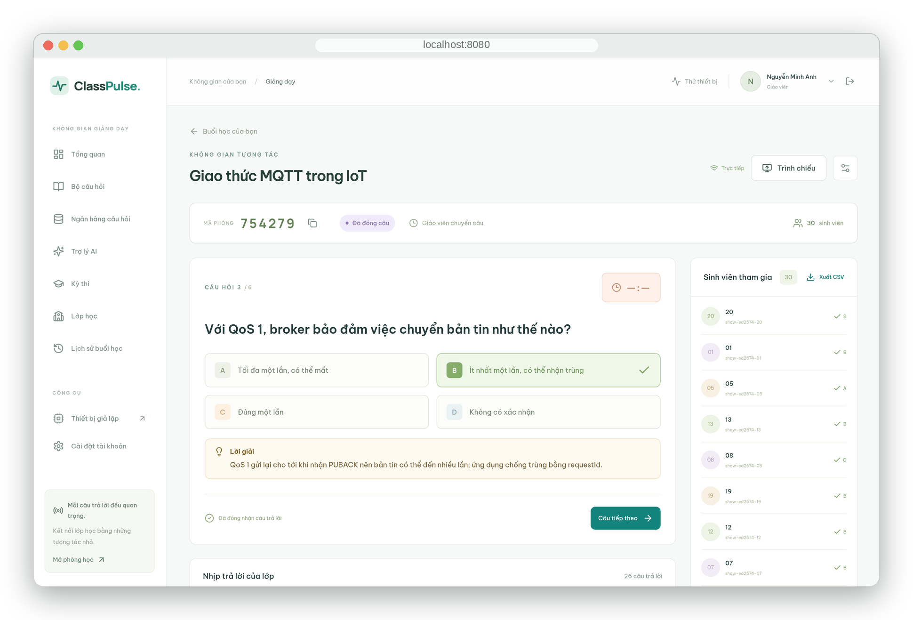</td>
<td width="50%">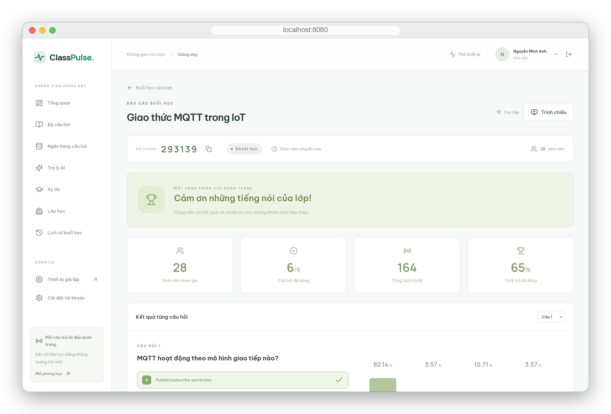</td>
</tr>
<tr>
<td align="center"><sub>Session control: room code, question controls and every student's status in real time</sub></td>
<td align="center"><sub>End-of-session report: participation, accuracy and per-question results, with CSV export</sub></td>
</tr>
</table>

The interface is in Vietnamese.

## How it works

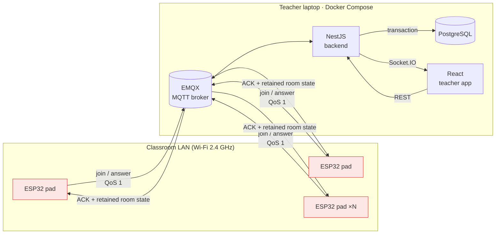

One answer, end to end:

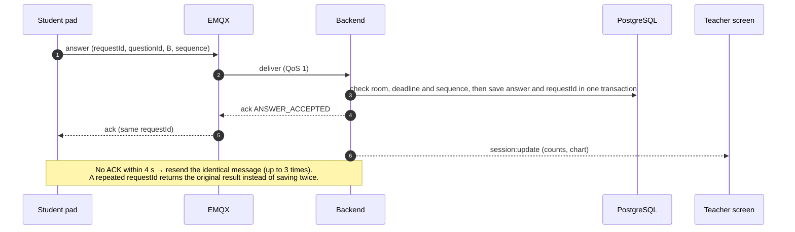

## Hardware

<table>
<tr><td>

| Block | Function |
|---|---|
| **M1** | 2 × AAA cells, slide switch |
| **M2** | P-MOSFET power gate: key-press wake, GPIO13 self-hold |
| **M3** | MT3608 boost to 3.37 V on the 3V3 pin |
| **M4** | ESP32-WROOM-32 module in sockets |
| **M5** | 4 × 4 keypad (16 keys), also wakes the board |
| **M6** | 74HC595 + two 7-segment digits, multiplexed every 2 ms |

</td><td>

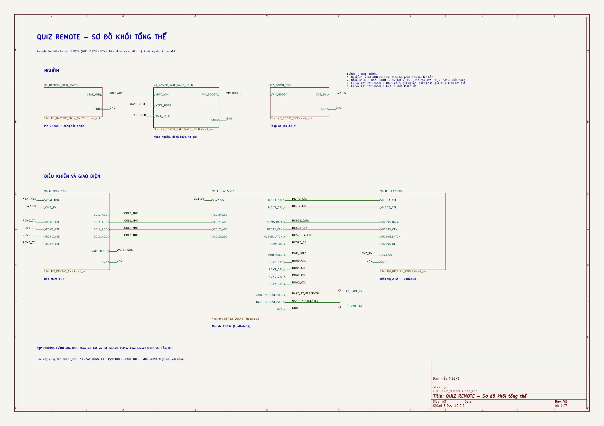

</td></tr>
</table>

<p align="center">&nbsp;&nbsp;&nbsp;<br><sub>The 52 × 90 mm two-layer board, front and back.</sub></p>

Schematic sheets, PCB, Gerber files, BOM and the full design rationale are in [`hardware/`](hardware/README.md) and the [design document](hardware/docs/design-document.md).

### What the digits show

| LED | Meaning | | LED | Meaning |
|:---:|---|---|:---:|---|
| `88` | Boot self-test | | `E1` | No Wi-Fi |
| `Ph` | Enter the room code | | `E2` | MQTT not connected |
| `Id` | Enter the student code | | `E3` | Rejected by the server |
| `On` | Connected to the server | | `E4` | Wrong number of digits |
| `01` | Question number | | `CF` | Wi-Fi setup page open |
| `A`…`d` | Selected answer | | `OF` | Powering off |

**Keys:** `1`–`4` choose A–D · `#` confirms · `*` deletes, or held 3 s powers off · `0` held 3 s opens Wi-Fi setup.

## Results

Measured with 50 simulated devices joining and answering at the same time, through the same broker and protocol as the real pads:

| Joined | Answers saved | Rejected / timed out | Duplicates saved twice | ACK latency p50 | p95 | max |
|:---:|:---:|:---:|:---:|:---:|:---:|:---:|
| **50 / 50** | **50 / 50** | **0** | **0** of 100 | **181 ms** | **371 ms** | **405 ms** |

The assembled board has completed a full quiz on two AAA cells over a phone hotspot. Full test report: [`web/docs/testing.md`](web/docs/testing.md).

## Repository layout

```text
.
├── hardware/                 KiCad 10 project, schematic PDFs/PNGs, Gerber, BOM, design document
│   ├── compact/              The current 52 × 90 mm board
│   ├── docs/                 Design document
│   └── tools/                PCB build script, ngspice wake/hold simulation, Wokwi sketch
├── firmware/                 Arduino sketches for the ESP32
│   ├── ClassPulseQuizDevice/       The quiz pad firmware (Wi-Fi, MQTT, power control, setup portal)
│   ├── ClassPulseKeypadDisplay/    Bring-up test: keypad → digits
│   └── ClassPulsePcbBreadboardTest/  Bring-up test: power latch, keys, segments, Wi-Fi
└── web/                      Server side, run with Docker Compose
    ├── apps/backend/         NestJS · Prisma · MQTT subscriber · REST · Socket.IO
    ├── apps/frontend/        React + Tailwind teacher app and presentation view
    ├── apps/device-simulator/  Browser pad simulator (MQTT over WebSocket)
    ├── packages/             Shared types and MQTT contracts (Zod)
    └── docs/                 Architecture, MQTT protocol, API, test report
```

## Quick start

**1. Server** (Docker with Compose v2):

```bash
cd web
cp .env.example .env          # fill in the <...> values
# set MQTT_TCP_BIND_ADDRESS to the laptop's Wi-Fi IP (hostname -I)
docker compose up --build -d
docker compose exec backend pnpm db:seed
```

Open **http://localhost:8080** and log in with the development account from the seed (see [`web/README.md`](web/README.md)).

**2. Device** (Arduino IDE, board *ESP32 Dev Module*): open `firmware/ClassPulseQuizDevice/ClassPulseQuizDevice.ino`, set `WIFI_SSID`, `WIFI_PASSWORD` and `MQTT_HOST` (the laptop's IP), then upload.

**3. Run a quiz:** start a session on the web → on the pad enter the room code `#`, a 2-digit student code `#` → answer with `1`–`4` and `#`.

> [!TIP]
> No spare pads? Add 30 simulated students to the same room:
> ```bash
> docker compose exec -e MQTT_URL=mqtt://emqx:1883 backend pnpm simulate --devices=30 --room=<room code>
> ```

> [!NOTE]
> The ESP32 only supports **2.4 GHz** Wi-Fi, and the pads and the laptop must be on the same network.

## Documentation

| Topic | Document |
|---|---|
| Board design, calculations, BOM | [hardware/README.md](hardware/README.md) · [design-document.md](hardware/docs/design-document.md) |
| Firmware configuration and usage | [firmware/ClassPulseQuizDevice/README.md](firmware/ClassPulseQuizDevice/README.md) |
| Server setup and features | [web/README.md](web/README.md) |
| System architecture and data model | [web/docs/architecture.md](web/docs/architecture.md) |
| MQTT topics, payloads, ACK codes | [web/docs/mqtt-protocol.md](web/docs/mqtt-protocol.md) |
| REST API and Socket.IO | [web/docs/api.md](web/docs/api.md) |
| Test report | [web/docs/testing.md](web/docs/testing.md) |

## License

Released under the [MIT License](LICENSE).
