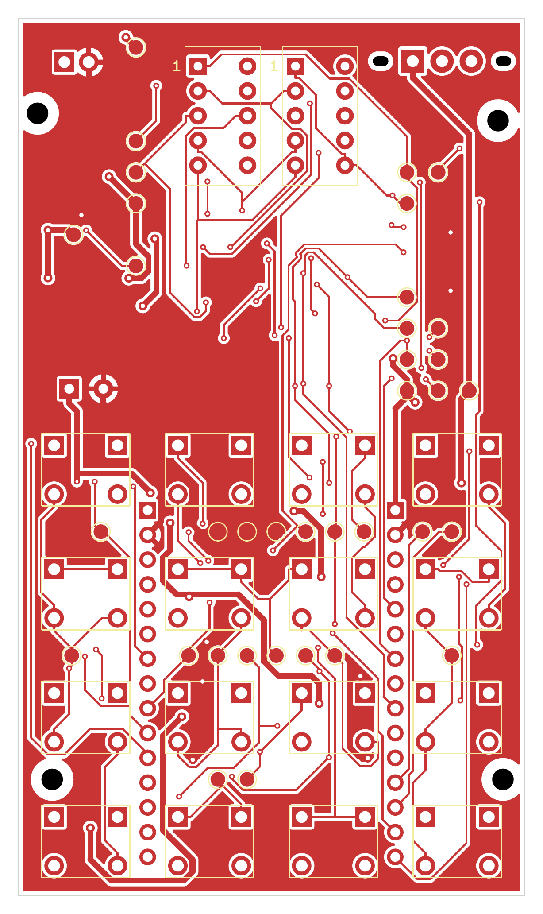
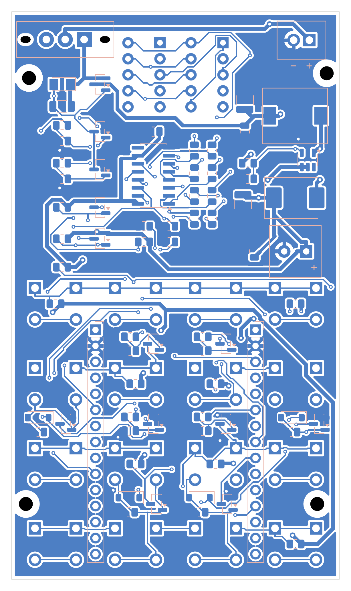

# Quiz Remote

A battery-powered handheld answer buzzer built around an ESP32. It has sixteen keys, two 7-segment digits and an ESP-NOW radio, and runs on two AAA cells. The board draws no power while idle: a key press wakes it, the ESP32 holds its own power while it works, and then it switches the whole board off.

| Front | Back |
|---|---|
|  |  |

## Overview

| | |
|---|---|
| Microcontroller | ESP32 NodeMCU LuaNode32, 30 pins, plugged into sockets so it can be removed for programming |
| Input | 4 × 4 matrix of 6 × 6 mm tactile switches (16 keys) |
| Display | Two 0.36" red 7-segment digits, common anode, driven by one 74HC595 shift register |
| Power | Two AAA cells in an external holder on connector JBAT; MT3608 boost converter to 3.37 V |
| Board | 52 × 90 mm, two layers, four M2 mounting holes |
| Parts cost | About 315,000 VND at prices of 2026-10-03, excluding AAA cells and shipping |

## How it works

1. **Idle.** No part of the circuit has power, including the ESP32, so the current drawn is only leakage.
2. **Key press.** A passive wake network pulls the gate of the power switch low. The switch turns on, the boost converter starts and the 3.37 V rail appears.
3. **Self-hold.** The ESP32 starts and drives `PWR_HOLD` (GPIO13) high, which keeps the power switch on after the key is released.
4. **Shutdown.** When the ESP32 releases `PWR_HOLD`, the power switch turns off and the board goes dark.

## Status

The design has been checked on a computer. It has not been assembled or measured yet.

| Check | Result |
|---|---|
| Schematic ERC | 0 errors |
| PCB DRC, with schematic parity | 0 violations, 0 unconnected items |
| Wake and self-hold simulation | Passes at 3.0 V and 2.4 V. The model has no leakage current, so it says nothing about idle current |

Still to measure: idle current, 3.3 V ripple and droop during radio bursts, boost behaviour at low battery voltage, and battery life.

## Repository

| Path | Contents |
|---|---|
| [`hardware/`](hardware/README.md) | The circuit: design process, KiCad project, schematic and board images, BOM, build scripts and simulations |
| [`hardware/docs/tai-lieu-thiet-ke-phan-cung.md`](hardware/docs/tai-lieu-thiet-ke-phan-cung.md) | Design document in Vietnamese: principles, calculations per block, ESP32 pin map, BOM with purchase links, test results |

## License

MIT. See [LICENSE](LICENSE).
