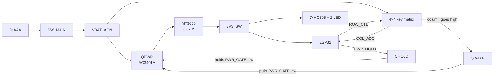

# Quiz Remote: Hardware Design Document

| | |
|---|---|
| Version | 1.2 |
| Date | 2026-10-15 |
| Scope | Schematic and PCB in `hardware/compact/` |
| Status | Checked with ERC, DRC and simulation; **assembled and running the ClassPulse firmware over Wi-Fi/MQTT** (full quiz completed on 2026-10-14). Idle current and battery life not yet measured |

## Contents

1. [Overview](#1-overview)
2. [Operating principle](#2-operating-principle)
3. [Design of each block](#3-design-of-each-block)
4. [ESP32 pin map and firmware conventions](#4-esp32-pin-map-and-firmware-conventions)
5. [PCB layout](#5-pcb-layout)
6. [Bill of materials (BOM)](#6-bill-of-materials-bom)
7. [Test results](#7-test-results)
8. [To do before and after ordering and assembly](#8-to-do-before-and-after-ordering-and-assembly)
9. [Revision history](#9-revision-history)

---

## 1. Overview

Quiz Remote is a handheld answer buzzer. The player presses one of 16 keys, the device shows the number on two 7-segment digits, sends the result over the ESP32 radio, and then switches itself off.

| Parameter | Value |
|---|---|
| Power | 2 AAA cells (separate battery holder, wired to connector JBAT) |
| Microcontroller | ESP32 NodeMCU LuaNode32 module, 30 pins, plugged into two female header rows |
| Keypad | 4 × 4 matrix, 6 × 6 mm tactile switches |
| Display | Two 0.36" 7-segment LEDs, common anode, scanned through a 74HC595 |
| 3.3 V supply | MT3608 boost converter, set to 3.37 V |
| Idle current | Designed so that only leakage remains (the whole board is cut off from power); not yet measured |
| PCB | 52 × 90 mm, 2 layers |
| Components | 92 symbols in the schematic (including the battery holder and the two header sockets), 36 test pads |

The main design requirement is **no current drawn when not in use**: no IC is powered while idle, including the ESP32. A key press is what powers the board.

## 2. Operating principle

Sequence of one key press:

1. **Idle.** QPWR is off, so the boost converter and the ESP32 have no power. The four row lines are pulled up to `VBAT_AON` through 22 kΩ, but no path leads to ground, so no current flows.
2. **Key press.** The key connects a row to a column, and the column rises close to the battery voltage. Current flows through the DWAKE diode into the base of QWAKE.
3. **Wake.** QWAKE pulls `PWR_GATE` to ground, QPWR conducts, the boost converter runs and `3V3_SW` appears.
4. **Self-hold.** The ESP32 starts and drives `PWR_HOLD` (GPIO13) high. QHOLD then holds `PWR_GATE` low in place of QWAKE. From this point the board stays powered after the key is released.
5. **Key scan and display.** The ESP32 scans the matrix, shows the number and sends the data.
6. **Shutdown.** The ESP32 pulls `PWR_HOLD` low. C_GATE recharges through R_GATE, QPWR turns off gradually, and the whole board loses power.

Capacitor C_GATE keeps QPWR conducting for a while after the key is released. This gives the ESP32 time to start and drive `PWR_HOLD`, even if the user only touches the key briefly.

## 3. Design of each block

Block names match the schematic sheet names.

### 3.1. M1: Battery and main switch

`JBAT → SW_MAIN → VBAT_AON`. SW_MAIN is a slide switch that fully disconnects the battery when the device is stored. JBAT is a two-pin XH2.54 connector: pin 1 is the battery positive terminal, pin 2 is ground.

### 3.2. M2: Power gate, wake and self-hold

| Part | Value | Role |
|---|---|---|
| QPWR | AO3401A | High-side power switch: S = `VBAT_AON`, D = `VIN_BOOST` |
| R_GATE | 220 kΩ | Pulls the QPWR gate up to the source (off) |
| C_GATE | 4.7 µF | Keeps QPWR conducting after the key is released |
| DWAKE0–3 | 1N4148W | Combines the four columns into one node, `WAKE_NODE` |
| R_WAKE / R_WAKE_PD | 100 kΩ / 1 MΩ | Limits current and pulls down the base of QWAKE |
| QWAKE, QHOLD | MMBT3904 | Pull `PWR_GATE` to ground |
| R_HOLD / R_HOLD_PD | 10 kΩ / 100 kΩ | Limits current and pulls down the base of QHOLD |

Calculations:

- **Hold time after release:** τ = R_GATE × C_GATE = 220 kΩ × 4.7 µF ≈ 1.03 s. QPWR stays on until |VGS| falls below the turn-on threshold (maximum 1.3 V per the AO3401A datasheet).
- **QWAKE base current on a key press (3.0 V battery):** about (3.0 - 0.6 - 0.65) V / (22 kΩ + 100 kΩ) ≈ 14 µA. QWAKE only needs to conduct about 3.0 V / 220 kΩ ≈ 14 µA to hold `PWR_GATE` low, and it must discharge C_GATE at first. The simulation in section 7 shows 3.3 V rising 5 to 7 ms after the press.
- **QHOLD base current:** (3.37 - 0.65) V / 10 kΩ ≈ 0.27 mA, well above the collector current required.
- **R_HOLD_PD** keeps QHOLD off while the GPIO13 pin floats, before the ESP32 starts.

### 3.3. M3: 3.3 V boost converter

MT3608 (U1) with inductor L1 22 µH, Schottky diode DBOOST SS34, input capacitors CIN1 22 µF and CIN2 100 nF, output capacitors COUT1 22 µF and COUT2 100 nF, and reservoir capacitor CRES 470 µF for the current pulses when the ESP32 transmits. The EN pin is tied to VIN together with `VIN_BOOST`, so the IC only runs while QPWR conducts.

The output voltage is set by the divider RFB1 = 180 kΩ and RFB4 = 39 kΩ with a 0.6 V reference:

> Vout = 0.6 V × (1 + 180 / 39) ≈ 3.37 V

Limitation: the boost converter stops working when the input voltage falls to about 2 V, so under load the battery is only usable down to about 2.3 to 2.4 V.

### 3.4. M4: ESP32 sockets

Two 1 × 15 female headers (J1, J2), 25.4 mm apart. The module is powered through its 3V3 pin (J2 pin 1). To program the module, remove it from the sockets and plug it into USB; do not program it while it sits on the board. Two UART pins are kept spare and brought out to test pads.

### 3.5. M5: 4 × 4 keypad

Each row has a 22 kΩ pull-up (RROW) to `VBAT_AON` and a transistor (QROW, MMBT3904) that pulls the row to ground when the ESP32 wants to deselect it. Each column has a 470 kΩ pull-down (RCOL), a diode (DWAKE) into the wake circuit, and a MOSFET (QCOL, BSS138) that inverts the level for the ESP32.

- **Column voltage on a key press:** Vbat × 470 / (470 + 22) ≈ 0.96 × Vbat, about 2.3 V when the battery is at 2.4 V. This is above the BSS138 turn-on threshold (maximum 1.5 V).
- **Reading a column:** QCOL pulls `COLx_ADC` to ground when a key is pressed. RSENSE (100 kΩ) pulls it up to `3V3_SW` when no key is pressed. The ESP32 reads **low = key pressed**.
- **Selecting a row:** `ROWx_CTL` high turns QROW on and pulls the row low (deselected). Low leaves the row selected. RBASE (10 kΩ) limits current, and RBASE_PD (100 kΩ) keeps QROW off while the ESP32 has no power, so any row can wake the board.

The circuit only reads correctly when one key is pressed at a time.

### 3.6. M6: Two-digit display

74HC595 (U2) drives segments A to G and DP through RSEG (470 Ω). Outputs QA to QH map to A to G and DP. Two P-channel MOSFETs, QDIG1 and QDIG2 (AO3401A), supply `3V3_SW` to the common anode of each digit. Their gates connect directly to GPIO17 and GPIO4, with RGP (4.7 kΩ) pull-ups so both digits stay off until the ESP32 takes control.

- **Current per segment:** about (3.37 - 1.9) V / 470 Ω ≈ 3 mA when lit. Scanning two digits gives an average of about 1.5 mA per segment. The 1.9 V figure is the typical forward drop of a red LED and has not been measured on the actual LED.
- **Power-up state:** ROE (10 kΩ) pulls OE high, which disables the outputs. RDATA_PD, RCLK_PD and RLATCH_PD (10 kΩ each) pull the control lines low. The SRCLR pin is tied directly to `3V3_SW`.

## 4. ESP32 pin map and firmware conventions

| Signal | GPIO | Active level | Notes |
|---|---|---|---|
| `PWR_HOLD` | 13 | High = hold power | Drive high as the first action in `setup()` |
| `ROW0_CTL` … `ROW3_CTL` | 25, 26, 27, 22 | Low = row selected | Other rows held high |
| `COL0_ADC` … `COL3_ADC` | 32, 33, 34, 35 | Low = key pressed | Pull-ups are already on the board |
| `HC595_DATA` | 23 | — | The last bit shifted in lands on QA (segment A) |
| `HC595_CLK` | 18 | Rising edge | |
| `HC595_LATCH` | 19 | Rising edge | |
| `HC595_OE` | 16 | Low = enabled | |
| `DIGIT1_CTL` (DS1) | 17 | **Low = on** | |
| `DIGIT2_CTL` (DS2) | 4 | **Low = on** | |
| LED segments | via U2 | Low = on | |

Firmware requirements:

1. Drive `PWR_HOLD` high as early as possible. According to the simulation, with a weak battery (2.4 V) and a short 50 ms press, this must be done within about 0.4 to 0.5 s after 3.3 V appears.
2. Scan the keys right after startup, while the user is still holding the key. If the key has already been released before the scan, the board stays awake but does not know which key was pressed.
3. On shutdown: turn off the display, drive `PWR_HOLD` low, then enter deep sleep so the ESP32 does not restart while the supply is dropping.

The sample program that follows this pin map is `hardware/tools/wokwi_sim/wokwi_sim.ino`.

## 5. PCB layout

| Parameter | Value |
|---|---|
| Size | 52 × 90 mm, 2 layers |
| Front side | 16 keys, two 7-segment LEDs, 36 test pads |
| Back side | ESP32 sockets, power circuit, 74HC595 and all other SMD parts |
| Signal traces | 0.2 mm wide, 0.2 mm clearance, via 0.6 / 0.3 mm |
| Power traces | 0.6 mm wide, via 0.9 / 0.45 mm |
| Copper pour | GND on both sides |
| Via count | 103 |
| Key pitch | 12.7 mm |

The board is generated by a script, not drawn by hand. Component positions are set in `hardware/tools/build_compact_pcb.py`, routing uses Freerouting, and then a GND copper pour is added. The boost converter's switching node (`SW_NODE`) is 17.3 mm long and passes through 2 vias.

The board has four M2 mounting holes (2.2 mm diameter): two on the top edge and two on the side edges between the third and fourth key rows. The board has no silkscreen part labels yet.

PDF versions with the same names are in `hardware/compact/exports/`. Schematic sheets are in `hardware/schematic/`.

## 6. Bill of materials (BOM)

Stock levels and prices were read from ThegioiIC and LinhKienX on 2026-10-03. Both change daily, so open the links and check again before ordering. "Qty used" is the count per board. "Order qty" includes the shop's minimum pack size and a few spares.

Quantities for each reference were checked against the netlist exported from the schematic on 2026-10-15. The complete list in table form is in `hardware/compact/bom.csv`. References marked with `?` are parts with names that have no number (for example `C_GATE`); they have not been renamed in the schematic yet.

### 6.1. Modules, ICs and semiconductors

| Ref | Qty used | Order qty | Part | Package | Supplier | Stock | Price each | Link |
|---|---:|---:|---|---|---|---:|---:|---|
| (plugs into J1, J2) | 1 | 1 | ESP32 NodeMCU LuaNode32, **30 pins**, CP2102 | Module | ThegioiIC | 697 | 131,100 VND | https://www.thegioiic.com/esp32-nodemcu-luanode32-module-thu-phat-wifi-30-chan |
| U1 | 1 | 3 | MT3608 boost converter IC, 2 A | SOT-23-6 | LinhKienX | 83 | 3,420 VND | https://linhkienx.com/mt3608-ic-dieu-chinh-tang-ap-2a-sot-23-6 |
| U2 | 1 | 2 | 74HC595D,118 (Nexperia) | SOIC-16 | ThegioiIC | 5,140 | 5,942 VND | https://www.thegioiic.com/74hc595d-118-ic-shift-register-8bit-16soic |
| QPWR, QDIG1, QDIG2 | 3 | 5 | AO3401A P-MOSFET, 30 V, 4 A | SOT-23 | ThegioiIC | 1,043 | 2,772 VND | https://www.thegioiic.com/ao3401a-mosfet-kenh-p-30v-4a-sot23 |
| QWAKE, QHOLD, QROW0–3 | 6 | 20 | MMBT3904-1AM NPN | SOT-23 | ThegioiIC | 11,902 | 399 VND | https://www.thegioiic.com/mmbt3904-1am-transistor-npn-40v-0-2a-3-chan-sot-23 |
| QCOL0–3 | 4 | 6 | BSS138LT1G N-MOSFET, 50 V, 200 mA | SOT-23 | ThegioiIC | 2,065 | 1,140 VND | https://www.thegioiic.com/bss138lt1g-mosfet-kenh-n-50v-200ma-sot-23 |
| DWAKE0–3 | 4 | 6 | 1N4148W-E3-18 | **SOD-123** | ThegioiIC | 378 | 2,280 VND | https://www.thegioiic.com/1n4148w-e3-18-diode-gen-purp-75v-150ma-sod123 |
| DBOOST | 1 | 2 | SS34 Schottky, 3 A, 40 V | **SMC** | LinhKienX | 369 | 1,710 VND | https://linhkienx.com/ss34-smc-diode-schottky-3a |
| DS1, DS2 | 2 | 3 | 3161BS 7-segment LED, 0.36", red, **common anode** | THT, 10 pins | ThegioiIC | **3** | 2,850 VND | https://www.thegioiic.com/3161bs-led-7-doan-0-36inch-do-1-so-duong-chung |

### 6.2. Inductors and capacitors

| Ref | Qty used | Order qty | Part | Package | Supplier | Stock | Price each | Link |
|---|---:|---:|---|---|---|---:|---:|---|
| L1 | 1 | 2 | Inductor 8D43-220, 22 µH, 3.25 A | SMD 8 × 8 × 4.3 mm | ThegioiIC | 204 | 3,990 VND | https://www.thegioiic.com/cuon-cam-dan-smd-8d43-220-22uh-3-25a |
| CIN1, COUT1 | 2 | 4 | Ceramic capacitor 22 µF, 25 V | **1210** | ThegioiIC | 348 | 2,850 VND | https://www.thegioiic.com/tu-gom-1210-22uf-25v |
| CIN2, COUT2, C_U2 | 3 | 20 | Ceramic capacitor 100 nF, 50 V | 0805 | ThegioiIC | 326,042 | 217 VND | https://www.thegioiic.com/tu-gom-0805-100nf-0-1uf-50v |
| CRES | 1 | 5 | Electrolytic capacitor 470 µF, 16 V | THT 8 × 12.5 mm | ThegioiIC | 2,263 | 912 VND | https://www.thegioiic.com/tu-hoa-470uf-16v-8x12-5mm-xuyen-lo |
| C_GATE | 1 | 2 | Tantalum capacitor 4.7 µF, 16 V, TAJA475K016RNJ | 1206 (case A) | ThegioiIC | 504 | 2,850 VND | https://www.thegioiic.com/tu-tantalum-4-7uf-16v-1206-taja475k016rnj |

### 6.3. Resistors

All are 0805, 1 %, except R_GATE, which is 1206. The shop sells a minimum of 50 of each value (25 for 1206).

| Ref | Qty used | Order qty | Value | Supplier | Stock | Price each | Link |
|---|---:|---:|---:|---|---:|---:|---|
| RSEG_A … RSEG_DP | 8 | 50 | 470 Ω | ThegioiIC | 32,923 | 95 VND | https://www.thegioiic.com/dien-tro-470-ohm-0805-1- |
| RGP1, RGP2 | 2 | 50 | 4.7 kΩ | ThegioiIC | 51,044 | 95 VND | https://www.thegioiic.com/dien-tro-4-7-kohm-0805-1- |
| RBASE0–3, R_HOLD, ROE, RDATA_PD, RCLK_PD, RLATCH_PD | 9 | 50 | 10 kΩ | ThegioiIC | 19,631 | 95 VND | https://www.thegioiic.com/dien-tro-10-kohm-0805-1- |
| RROW0–3 | 4 | 50 | 22 kΩ | ThegioiIC | 3,400 | 95 VND | https://www.thegioiic.com/dien-tro-22-kohm-0805-1- |
| RFB4 | 1 | 50 | 39 kΩ | ThegioiIC | 3,800 | 95 VND | https://www.thegioiic.com/dien-tro-39-kohm-0805-1- |
| RBASE_PD0–3, RSENSE0–3, R_HOLD_PD, R_WAKE | 10 | 50 | 100 kΩ | ThegioiIC | 23,700 | 95 VND | https://www.thegioiic.com/dien-tro-100-kohm-0805-1- |
| RFB1 | 1 | 50 | 180 kΩ | ThegioiIC | 2,000 | 95 VND | https://www.thegioiic.com/dien-tro-180-kohm-0805-1- |
| RCOL0–3 | 4 | 50 | 470 kΩ | ThegioiIC | 7,538 | 95 VND | https://www.thegioiic.com/dien-tro-470-kohm-0805-1- |
| R_WAKE_PD | 1 | 50 | 1 MΩ | ThegioiIC | 8,500 | 95 VND | https://www.thegioiic.com/dien-tro-1-mohm-0805-1- |
| R_GATE | 1 | 25 | 220 kΩ, **1206** | ThegioiIC | 3,125 | 114 VND | https://www.thegioiic.com/dien-tro-220-kohm-1206-1- |

### 6.4. Switches, connectors and battery

| Ref | Qty used | Order qty | Part | Notes | Supplier | Stock | Price each | Link |
|---|---:|---:|---|---|---|---:|---:|---|
| SW1–SW16 | 16 | 20 | 6 × 6 mm tactile switch, 4.3 mm high, 4 pins | Through-hole | ThegioiIC | 2,730 | 342 VND | https://www.thegioiic.com/nut-nhan-6x6mm-cao-4-3mm-4-chan-xuyen-lo |
| SW_MAIN | 1 | 10 | SS-12F23G4 slide switch, 5 pins | Through-hole, horizontal slide; shop minimum 10 | ThegioiIC | 415 | 855 VND | https://www.thegioiic.com/ss-12f23g4-cong-tac-truot-5-chan-xuyen-lo |
| JBAT | 1 | 5 | XH2.54 2-pin straight connector set, with housing and crimp pins | Pin header soldered to the board; housing crimped onto the battery holder wire | ThegioiIC | 4,935 | 855 VND | https://www.thegioiic.com/bo-dau-noi-xh2-54mm-2-chan-thang-kem-kim-bam-day |
| BT1 | 1 | 1 | 2 × AAA battery holder, 15 cm lead | Off-board | ThegioiIC | 47 | 3,420 VND | https://www.thegioiic.com/hop-pin-khay-pin-2xaaa-day-noi-dai-15cm |
| J1, J2 | 2 × 15 pins | 2 strips | 2.54 mm single female header, 1 × 40, 11.8 mm high | Cut each strip into a 1 × 15 piece | ThegioiIC | 2,810 | 2,622 VND | https://www.thegioiic.com/hang-rao-cai-don-2-54mm-40-chan-1-hang-cao-11-8mm-xuyen-lo |
| — | 2 | 2 | AAA alkaline cells | Buy separately | — | — | — | — |

Total from the "Order qty" column, excluding AAA cells and shipping: about **315,000 VND**, of which the ESP32 module is 131,100 VND.

### 6.5. Backup suppliers

| Part | Second supplier | Stock | Link |
|---|---|---:|---|
| BSS138LT1G | LinhKienX | 783 | https://linhkienx.com/bss138lt1g-mosfet-kenh-n-50v-200ma-sot-23 |
| 1N4148W-E3-18, SOD-123 | LinhKienX | 177 | https://linhkienx.com/1n4148w-e3-18-diode-gen-purp-75v-150ma-sod123 |
| Tantalum TAJA475K016RNJ | LinhKienX | 61 | https://linhkienx.com/tu-tantalum-4-7uf-16v-1206-taja475k016rnj |
| 6 × 6 mm tactile switch, 4.3 mm high, through-hole | LinhKienX | 1,600 | https://linhkienx.com/nut-nhan-6x6mm-cao-4-3mm-4-chan-xuyen-lo |
| SS-12F23G4 | LinhKienX | 924 | https://linhkienx.com/ss-12f23g4-cong-tac-truot-chinh-ngang-on-off-5-chan-xuyen-lo-1p2t-2a |
| XH2.54 2-pin straight header (male only) | LinhKienX | 6,408 | https://linhkienx.com/dau-xh2-54mm-2-chan-thang-xuyen-lo |
| 2 × AAA battery holder, 15 cm lead | LinhKienX | 49 | https://linhkienx.com/hop-pin-khay-pin-2xaaa-day-noi-dai-15cm |

### 6.6. Notes before ordering

1. **3161BS LED running low:** ThegioiIC has only 3 left and LinhKienX is out of stock. The board needs 2.
2. **MT3608:** only LinhKienX has loose ICs. The shop lists "MT3608", but the schematic says MT3608L. Check the marking on the IC when it arrives, and do not buy the MT3608 mini module by mistake.
3. **SS34 must be the SMC package.** The SMA and SMB packages do not fit the pads.
4. **1N4148W must be SOD-123.** The SOD-323 part with the same name does not fit the pads.
5. **BSS138:** the schematic says LBSS138LT1G, which neither shop has. BSS138LT1G has the same SOT-23 package and pin order, so it can be used instead.
6. **The 22 µF capacitor must be 1210 size, 25 V.**
7. **The ESP32 module must be the 30-pin version.**
8. **The LED must be common anode.**
9. Test pads (TP_…) are copper pads on the board, not parts to buy.

## 7. Test results

Sections 7.1 to 7.3 were checked on a computer before assembly. The assembled board has since completed a full quiz over Wi-Fi/MQTT on two AAA cells (2026-10-14), with the Wi-Fi transmit power set to 8.5 dBm and the CPU to 80 MHz. The bench measurements listed in section 8 are still open.

### 7.1. Rule checks (rerun 2026-10-03)

| Check | Command | Result |
|---|---|---|
| ERC schematic | `kicad-cli sch erc hardware/compact/quiz_remote.kicad_sch` | 0 errors |
| PCB DRC, with schematic parity | `kicad-cli pcb drc --schematic-parity hardware/compact/quiz_remote.kicad_pcb` | 0 violations, 0 unconnected traces, 0 mismatches with the schematic |

### 7.2. Simulation of the wake and self-hold circuit

Command: `python3 hardware/tools/sim_wake_hold.py` (uses the ngspice library that comes with KiCad). The boost converter and ESP32 are replaced by behavioural models, and the transistors use generic models.

| Battery | Key held | ESP32 start-up | Power held | Smallest \|VGS\| of QPWR | Off after `PWR_HOLD` is released |
|---|---|---|---|---|---|
| 3.0 V | 200 ms | 300 ms | Yes | 2.63 V | 1.0 s |
| 3.0 V | 50 ms | 300 ms | Yes | 2.28 V | 1.0 s |
| 2.4 V | 50 ms | 300 ms | Yes | 1.81 V | 0.77 s |
| 2.4 V | 50 ms | 600 ms | Yes, just at the limit | 1.36 V | 0.77 s |
| 2.4 V | 50 ms | 1500 ms | **No** | 0.57 V | — |

In every case, `3V3_SW` rises 5 to 7 ms after the press, and the column reads the key at the correct level. The idle current in the simulation is zero because the model has no leakage. This figure cannot replace a measurement.

### 7.3. Firmware simulation

The folder `hardware/tools/wokwi_sim/` contains a program and a diagram for wokwi.com. This simulation only checks the key-scan and display logic. It has no self-holding power circuit, and the digit-select pins are wired directly, so their polarity is the reverse of the real board. Switch between the two with `#define WOKWI`.

## 8. To do before and after ordering and assembly

Before ordering:

1. Measure the real ESP32 module: the spacing between the two header rows (the board assumes 25.4 mm) and the pin position relative to the module edge.
2. Check the direction of the SW_MAIN slide switch on the board against the enclosure.
3. Add part labels to the silkscreen if needed.

After assembly, these measurements are still open:

| Item | How to measure | Expected |
|---|---|---|
| Idle current | Microammeter in series with the battery, no key pressed | Only leakage, below a few µA |
| `3V3_SW` voltage | Multimeter, while the board is awake | About 3.37 V |
| Ripple and droop during transmission | Oscilloscope on `3V3_SW` | The ESP32 does not restart |
| Wake with a short tap, weak battery | Bench supply set to 2.4 V | The board stays powered |
| Shutdown time | Oscilloscope on `PWR_GATE` | About 1 s after `PWR_HOLD` is pulled low |
| Battery life | Measure the energy of one key press | No data yet |

## 9. Revision history

| Version | Date | Changes |
|---|---|---|
| 1.0 | 2026-10-03 | First version for the 52 × 90 mm board. Principles, calculations and BOM merged into one document. Compared with earlier drafts: the display has two digits driven by one 74HC595; the digit-select pins drive the MOSFETs directly (low = on); the LED segment resistors are 470 Ω; the feedback divider is 180 kΩ / 39 kΩ. |
| 1.1 | 2026-10-15 | Moved the document and board into `hardware/`. Added front and back board images and per-sheet schematic images. The BOM is checked against the netlist and has a CSV file. The circuit is unchanged. |
| 1.2 | 2026-10-15 | Translated the document into English and renamed it `design-document.md`. The circuit is unchanged. |
