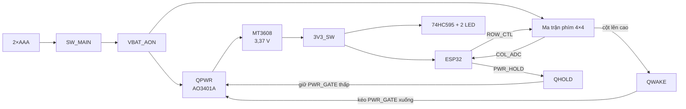

# Quiz Remote — Tài liệu thiết kế phần cứng

| | |
|---|---|
| Phiên bản | 1.1 |
| Ngày | 2026-10-15 |
| Phạm vi | Schematic và PCB trong `hardware/compact/` |
| Trạng thái | Đã qua kiểm tra ERC, DRC và mô phỏng; **chưa lắp và đo trên mạch thật** |

## Mục lục

1. [Tổng quan](#1-tổng-quan)
2. [Nguyên lý hoạt động](#2-nguyên-lý-hoạt-động)
3. [Thiết kế từng khối](#3-thiết-kế-từng-khối)
4. [Bảng chân ESP32 và quy ước cho firmware](#4-bảng-chân-esp32-và-quy-ước-cho-firmware)
5. [Mạch in](#5-mạch-in)
6. [Danh mục linh kiện (BOM)](#6-danh-mục-linh-kiện-bom)
7. [Kết quả kiểm tra](#7-kết-quả-kiểm-tra)
8. [Việc phải làm trước và sau khi đặt mạch](#8-việc-phải-làm-trước-và-sau-khi-đặt-mạch)
9. [Lịch sử thay đổi](#9-lịch-sử-thay-đổi)

---

## 1. Tổng quan

Quiz Remote là bộ bấm trả lời cầm tay: người dùng bấm một trong 16 phím, thiết bị hiện số trên hai LED 7 thanh và gửi kết quả qua sóng của ESP32, sau đó tự tắt.

| Thông số | Giá trị |
|---|---|
| Nguồn | 2 pin AAA (hộp pin rời, nối dây vào đầu JBAT) |
| Vi điều khiển | Module ESP32 NodeMCU LuaNode32 30 chân, cắm trên hai hàng rào cái |
| Bàn phím | Ma trận 4×4, nút nhấn 6×6 mm |
| Hiển thị | 2 LED 7 thanh 0,36", dương chung, quét qua 74HC595 |
| Nguồn 3,3 V | Mạch tăng áp MT3608, đặt 3,37 V |
| Dòng khi nghỉ | Thiết kế để chỉ còn dòng rò (toàn bộ mạch bị cắt nguồn); chưa đo |
| Mạch in | 52 × 90 mm, 2 lớp |
| Linh kiện | 92 ký hiệu trong schematic (kể cả khay pin và hai đầu cắm), 36 pad đo |

Yêu cầu thiết kế chính là **không tiêu dòng khi không dùng**: không có IC nào được cấp nguồn lúc nghỉ, kể cả ESP32. Chính phím bấm cấp nguồn cho mạch.

## 2. Nguyên lý hoạt động

Trình tự một lần bấm:

1. **Nghỉ.** QPWR tắt, mạch tăng áp và ESP32 không có nguồn. Bốn hàng phím được kéo lên `VBAT_AON` qua 22 kΩ, nhưng không có đường nào về đất nên không có dòng.
2. **Bấm phím.** Phím nối hàng với cột; cột lên gần điện áp pin. Dòng đi qua diode DWAKE vào cực B của QWAKE.
3. **Đánh thức.** QWAKE kéo `PWR_GATE` xuống đất, QPWR dẫn, mạch tăng áp chạy và `3V3_SW` xuất hiện.
4. **Tự giữ.** ESP32 khởi động và kéo `PWR_HOLD` (GPIO13) lên cao; QHOLD giữ `PWR_GATE` ở mức thấp thay cho QWAKE. Từ lúc này nhả phím mạch vẫn có nguồn.
5. **Đọc phím và hiển thị.** ESP32 quét ma trận, hiện số, gửi dữ liệu.
6. **Tắt.** ESP32 hạ `PWR_HOLD`. C_GATE nạp lại qua R_GATE, QPWR tắt dần và toàn mạch mất nguồn.

Tụ C_GATE giữ QPWR dẫn thêm một lúc sau khi nhả phím, để ESP32 kịp khởi động và kéo `PWR_HOLD` ngay cả khi người dùng chỉ chạm rất nhanh.

## 3. Thiết kế từng khối

Tên khối trùng tên trang schematic.

### 3.1. M1 — Pin và công tắc chính

`JBAT → SW_MAIN → VBAT_AON`. SW_MAIN là công tắc trượt cắt hẳn pin khi cất thiết bị. JBAT là đầu XH2.54 hai chân: chân 1 là dương pin, chân 2 là đất.

### 3.2. M2 — Khoá nguồn, đánh thức và tự giữ

| Linh kiện | Giá trị | Vai trò |
|---|---|---|
| QPWR | AO3401A | Khoá nguồn phía cao: S = `VBAT_AON`, D = `VIN_BOOST` |
| R_GATE | 220 kΩ | Kéo cực G của QPWR về nguồn (tắt) |
| C_GATE | 4,7 µF | Giữ QPWR dẫn sau khi nhả phím |
| DWAKE0–3 | 1N4148W | Gộp bốn cột về một nút `WAKE_NODE` |
| R_WAKE / R_WAKE_PD | 100 kΩ / 1 MΩ | Hạn dòng và kéo xuống cho cực B của QWAKE |
| QWAKE, QHOLD | MMBT3904 | Kéo `PWR_GATE` xuống đất |
| R_HOLD / R_HOLD_PD | 10 kΩ / 100 kΩ | Hạn dòng và kéo xuống cho cực B của QHOLD |

Tính toán:

- **Thời gian giữ sau khi nhả:** τ = R_GATE × C_GATE = 220 kΩ × 4,7 µF ≈ 1,03 s. QPWR còn dẫn cho tới khi |VGS| tụt xuống dưới ngưỡng mở (tối đa 1,3 V theo datasheet AO3401A).
- **Dòng cực B của QWAKE khi bấm (pin 3,0 V):** khoảng (3,0 - 0,6 - 0,65) V / (22 kΩ + 100 kΩ) ≈ 14 µA. QWAKE chỉ cần dẫn khoảng 3,0 V / 220 kΩ ≈ 14 µA để giữ `PWR_GATE` thấp, và phải xả C_GATE lúc đầu; kết quả mô phỏng ở mục 7 cho thấy 3,3 V lên sau 5–7 ms.
- **Dòng cực B của QHOLD:** (3,37 - 0,65) V / 10 kΩ ≈ 0,27 mA, dư nhiều so với dòng cực C cần thiết.
- **R_HOLD_PD** giữ QHOLD tắt khi chân GPIO13 còn thả nổi lúc ESP32 chưa chạy.

### 3.3. M3 — Tăng áp 3,3 V

MT3608 (U1) với cuộn cảm L1 22 µH, diode Schottky DBOOST SS34, tụ vào CIN1 22 µF + CIN2 100 nF, tụ ra COUT1 22 µF + COUT2 100 nF và tụ dự trữ CRES 470 µF cho các xung dòng khi ESP32 phát sóng. Chân EN nối cùng VIN vào `VIN_BOOST`, nên IC chỉ chạy khi QPWR dẫn.

Điện áp ra đặt bằng cầu phân áp RFB1 = 180 kΩ, RFB4 = 39 kΩ với điện áp tham chiếu 0,6 V:

> Vout = 0,6 V × (1 + 180 / 39) ≈ 3,37 V

Giới hạn cần biết: mạch tăng áp ngừng hoạt động khi điện áp vào xuống khoảng 2 V, nên pin chỉ dùng được tới khoảng 2,3–2,4 V khi có tải.

### 3.4. M4 — Đế cắm ESP32

Hai hàng rào cái 1×15 (J1, J2), cách nhau 25,4 mm. Module được cấp qua chân 3V3 (J2 chân 1). Nạp chương trình bằng cách rút module ra khỏi đế và cắm USB; không nạp khi module đang nằm trên board. Hai chân UART được để dành và đưa ra pad đo.

### 3.5. M5 — Bàn phím 4×4

Mỗi hàng có điện trở kéo lên RROW 22 kΩ về `VBAT_AON` và một transistor QROW (MMBT3904) kéo hàng xuống đất khi ESP32 muốn bỏ chọn hàng đó. Mỗi cột có điện trở kéo xuống RCOL 470 kΩ, một diode DWAKE về mạch đánh thức và một MOSFET QCOL (BSS138) đảo mức để ESP32 đọc.

- **Điện áp cột khi bấm:** Vbat × 470 / (470 + 22) ≈ 0,96 × Vbat, tức khoảng 2,3 V khi pin còn 2,4 V; cao hơn ngưỡng mở của BSS138 (tối đa 1,5 V).
- **Đọc cột:** QCOL kéo `COLx_ADC` xuống đất khi có phím; RSENSE 100 kΩ kéo lên `3V3_SW` khi không có phím. ESP32 đọc **mức thấp = có phím**.
- **Chọn hàng:** `ROWx_CTL` ở mức cao thì QROW dẫn và hàng bị kéo xuống (bỏ chọn); mức thấp thì hàng được chọn. RBASE 10 kΩ hạn dòng, RBASE_PD 100 kΩ giữ QROW tắt khi ESP32 chưa có nguồn, nhờ đó mọi hàng đều đánh thức được mạch.

Mạch chỉ nhận đúng khi bấm một phím một lúc.

### 3.6. M6 — Hiển thị hai số

74HC595 (U2) điều khiển tám thanh A–G và DP qua RSEG 470 Ω; đầu ra QA…QH ứng với A…G, DP. Hai MOSFET kênh P QDIG1, QDIG2 (AO3401A) cấp `3V3_SW` cho chân dương chung của từng số; cực G nối thẳng vào GPIO17 và GPIO4, có RGP 4,7 kΩ kéo lên để cả hai số tắt khi ESP32 chưa điều khiển.

- **Dòng mỗi thanh:** khoảng (3,37 - 1,9) V / 470 Ω ≈ 3 mA khi sáng; quét hai số nên trung bình khoảng 1,5 mA mỗi thanh. Giá trị 1,9 V là điện áp rơi điển hình của LED đỏ, chưa đo trên LED thật.
- **Trạng thái lúc cấp nguồn:** ROE 10 kΩ kéo chân OE lên (đầu ra bị khoá); RDATA_PD, RCLK_PD, RLATCH_PD 10 kΩ kéo các đường điều khiển xuống. Chân SRCLR nối thẳng `3V3_SW`.

## 4. Bảng chân ESP32 và quy ước cho firmware

| Tín hiệu | GPIO | Mức tích cực | Ghi chú |
|---|---|---|---|
| `PWR_HOLD` | 13 | Cao = giữ nguồn | Kéo lên ngay dòng đầu tiên của `setup()` |
| `ROW0_CTL` … `ROW3_CTL` | 25, 26, 27, 22 | Thấp = chọn hàng | Các hàng còn lại để mức cao |
| `COL0_ADC` … `COL3_ADC` | 32, 33, 34, 35 | Thấp = có phím | Đã có điện trở kéo lên trên board |
| `HC595_DATA` | 23 | — | Bit cuối cùng đẩy vào nằm ở QA (thanh A) |
| `HC595_CLK` | 18 | Sườn lên | |
| `HC595_LATCH` | 19 | Sườn lên | |
| `HC595_OE` | 16 | Thấp = cho phép | |
| `DIGIT1_CTL` (DS1) | 17 | **Thấp = sáng** | |
| `DIGIT2_CTL` (DS2) | 4 | **Thấp = sáng** | |
| Thanh LED | qua U2 | Thấp = sáng | |

Yêu cầu với firmware:

1. Kéo `PWR_HOLD` lên càng sớm càng tốt. Theo mô phỏng, với pin yếu (2,4 V) và lần bấm ngắn 50 ms, việc này phải xong trong khoảng 0,4–0,5 s kể từ khi có 3,3 V.
2. Quét phím ngay sau khi khởi động, khi người dùng còn giữ phím. Nếu phím đã nhả trước khi quét thì mạch vẫn thức nhưng không biết phím nào đã bấm.
3. Khi tắt: tắt hiển thị, hạ `PWR_HOLD`, rồi gọi ngủ sâu để ESP32 không chạy lại trong lúc nguồn đang tụt.

Chương trình mẫu theo đúng bảng chân này nằm ở `hardware/tools/wokwi_sim/wokwi_sim.ino`.

## 5. Mạch in

| Thông số | Giá trị |
|---|---|
| Kích thước | 52 × 90 mm, 2 lớp |
| Mặt trước | 16 phím, hai LED 7 thanh, 36 pad đo |
| Mặt sau | Đế ESP32, mạch nguồn, 74HC595 và toàn bộ linh kiện dán |
| Đường tín hiệu | Rộng 0,2 mm, hở 0,2 mm, via 0,6 / 0,3 mm |
| Đường nguồn | Rộng 0,6 mm, via 0,9 / 0,45 mm |
| Đổ đồng | GND trên cả hai mặt |
| Số via | 103 |
| Khoảng cách phím | 12,7 mm |

Board được tạo bằng script, không vẽ tay: vị trí linh kiện ghi trong `hardware/tools/build_compact_pcb.py`, đi dây bằng Freerouting, sau đó đổ đồng GND. Nút chuyển mạch của mạch tăng áp (`SW_NODE`) dài 17,3 mm và đi qua 2 via.

Board có 4 lỗ bắt vít M2 (đường kính 2,2 mm): hai lỗ ở hai mép trên, hai lỗ ở hai mép bên giữa hàng phím thứ ba và thứ tư. Board chưa có chữ in tên linh kiện.

Ảnh PDF cùng tên nằm trong `hardware/compact/exports/`. Sơ đồ từng sheet nằm trong `hardware/schematic/`.

## 6. Danh mục linh kiện (BOM)

Tồn kho và giá đọc từ trang ThegioiIC và LinhKienX ngày 2026-10-03; cả hai thay đổi theo ngày, cần mở link kiểm tra lại trước khi đặt. Cột "SL dùng" là cho một board; cột "Nên mua" đã tính số lượng bán tối thiểu của shop và vài con dự phòng.

Số lượng từng ref được đối chiếu với netlist xuất từ schematic ngày 2026-10-15; danh sách đầy đủ dạng bảng nằm ở `hardware/compact/bom.csv`. Các ref có dấu `?` là linh kiện đặt tên không đánh số (ví dụ `C_GATE`), chưa đổi tên trên schematic.

### 6.1. Module, IC và bán dẫn

| Ref | SL dùng | Nên mua | Linh kiện | Package | Mua ở | Tồn kho | Giá/con | Link |
|---|---:|---:|---|---|---|---:|---:|---|
| (cắm vào J1, J2) | 1 | 1 | ESP32 NodeMCU LuaNode32, **30 chân**, CP2102 | Module | ThegioiIC | 697 | 131.100 đ | https://www.thegioiic.com/esp32-nodemcu-luanode32-module-thu-phat-wifi-30-chan |
| U1 | 1 | 3 | MT3608 IC tăng áp 2 A | SOT-23-6 | LinhKienX | 83 | 3.420 đ | https://linhkienx.com/mt3608-ic-dieu-chinh-tang-ap-2a-sot-23-6 |
| U2 | 1 | 2 | 74HC595D,118 (Nexperia) | SOIC-16 | ThegioiIC | 5.140 | 5.942 đ | https://www.thegioiic.com/74hc595d-118-ic-shift-register-8bit-16soic |
| QPWR, QDIG1, QDIG2 | 3 | 5 | AO3401A P-MOSFET 30 V 4 A | SOT-23 | ThegioiIC | 1.043 | 2.772 đ | https://www.thegioiic.com/ao3401a-mosfet-kenh-p-30v-4a-sot23 |
| QWAKE, QHOLD, QROW0–3 | 6 | 20 | MMBT3904-1AM NPN | SOT-23 | ThegioiIC | 11.902 | 399 đ | https://www.thegioiic.com/mmbt3904-1am-transistor-npn-40v-0-2a-3-chan-sot-23 |
| QCOL0–3 | 4 | 6 | BSS138LT1G N-MOSFET 50 V 200 mA | SOT-23 | ThegioiIC | 2.065 | 1.140 đ | https://www.thegioiic.com/bss138lt1g-mosfet-kenh-n-50v-200ma-sot-23 |
| DWAKE0–3 | 4 | 6 | 1N4148W-E3-18 | **SOD-123** | ThegioiIC | 378 | 2.280 đ | https://www.thegioiic.com/1n4148w-e3-18-diode-gen-purp-75v-150ma-sod123 |
| DBOOST | 1 | 2 | SS34 Schottky 3 A 40 V | **SMC** | LinhKienX | 369 | 1.710 đ | https://linhkienx.com/ss34-smc-diode-schottky-3a |
| DS1, DS2 | 2 | 3 | 3161BS LED 7 thanh đỏ 0,36", **dương chung** | THT 10 chân | ThegioiIC | **3** | 2.850 đ | https://www.thegioiic.com/3161bs-led-7-doan-0-36inch-do-1-so-duong-chung |

### 6.2. Cuộn cảm và tụ

| Ref | SL dùng | Nên mua | Linh kiện | Package | Mua ở | Tồn kho | Giá/con | Link |
|---|---:|---:|---|---|---|---:|---:|---|
| L1 | 1 | 2 | Cuộn cảm 8D43-220, 22 µH 3,25 A | SMD 8×8×4,3 mm | ThegioiIC | 204 | 3.990 đ | https://www.thegioiic.com/cuon-cam-dan-smd-8d43-220-22uh-3-25a |
| CIN1, COUT1 | 2 | 4 | Tụ gốm 22 µF 25 V | **1210** | ThegioiIC | 348 | 2.850 đ | https://www.thegioiic.com/tu-gom-1210-22uf-25v |
| CIN2, COUT2, C_U2 | 3 | 20 | Tụ gốm 100 nF 50 V | 0805 | ThegioiIC | 326.042 | 217 đ | https://www.thegioiic.com/tu-gom-0805-100nf-0-1uf-50v |
| CRES | 1 | 5 | Tụ hóa 470 µF 16 V | THT 8×12,5 mm | ThegioiIC | 2.263 | 912 đ | https://www.thegioiic.com/tu-hoa-470uf-16v-8x12-5mm-xuyen-lo |
| C_GATE | 1 | 2 | Tụ tantalum 4,7 µF 16 V TAJA475K016RNJ | 1206 (case A) | ThegioiIC | 504 | 2.850 đ | https://www.thegioiic.com/tu-tantalum-4-7uf-16v-1206-taja475k016rnj |

### 6.3. Điện trở

Tất cả là 0805, 1 %, trừ R_GATE là 1206. Shop bán tối thiểu 50 con mỗi giá trị (25 con với 1206).

| Ref | SL dùng | Nên mua | Giá trị | Mua ở | Tồn kho | Giá/con | Link |
|---|---:|---:|---:|---|---:|---:|---|
| RSEG_A … RSEG_DP | 8 | 50 | 470 Ω | ThegioiIC | 32.923 | 95 đ | https://www.thegioiic.com/dien-tro-470-ohm-0805-1- |
| RGP1, RGP2 | 2 | 50 | 4,7 kΩ | ThegioiIC | 51.044 | 95 đ | https://www.thegioiic.com/dien-tro-4-7-kohm-0805-1- |
| RBASE0–3, R_HOLD, ROE, RDATA_PD, RCLK_PD, RLATCH_PD | 9 | 50 | 10 kΩ | ThegioiIC | 19.631 | 95 đ | https://www.thegioiic.com/dien-tro-10-kohm-0805-1- |
| RROW0–3 | 4 | 50 | 22 kΩ | ThegioiIC | 3.400 | 95 đ | https://www.thegioiic.com/dien-tro-22-kohm-0805-1- |
| RFB4 | 1 | 50 | 39 kΩ | ThegioiIC | 3.800 | 95 đ | https://www.thegioiic.com/dien-tro-39-kohm-0805-1- |
| RBASE_PD0–3, RSENSE0–3, R_HOLD_PD, R_WAKE | 10 | 50 | 100 kΩ | ThegioiIC | 23.700 | 95 đ | https://www.thegioiic.com/dien-tro-100-kohm-0805-1- |
| RFB1 | 1 | 50 | 180 kΩ | ThegioiIC | 2.000 | 95 đ | https://www.thegioiic.com/dien-tro-180-kohm-0805-1- |
| RCOL0–3 | 4 | 50 | 470 kΩ | ThegioiIC | 7.538 | 95 đ | https://www.thegioiic.com/dien-tro-470-kohm-0805-1- |
| R_WAKE_PD | 1 | 50 | 1 MΩ | ThegioiIC | 8.500 | 95 đ | https://www.thegioiic.com/dien-tro-1-mohm-0805-1- |
| R_GATE | 1 | 25 | 220 kΩ, **1206** | ThegioiIC | 3.125 | 114 đ | https://www.thegioiic.com/dien-tro-220-kohm-1206-1- |

### 6.4. Công tắc, đầu nối, pin

| Ref | SL dùng | Nên mua | Linh kiện | Ghi chú | Mua ở | Tồn kho | Giá/con | Link |
|---|---:|---:|---|---|---|---:|---:|---|
| SW1–SW16 | 16 | 20 | Nút nhấn 6×6 mm cao 4,3 mm, 4 chân | Xuyên lỗ | ThegioiIC | 2.730 | 342 đ | https://www.thegioiic.com/nut-nhan-6x6mm-cao-4-3mm-4-chan-xuyen-lo |
| SW_MAIN | 1 | 10 | Công tắc trượt SS-12F23G4, 5 chân | Xuyên lỗ, gạt ngang; shop bán tối thiểu 10 | ThegioiIC | 415 | 855 đ | https://www.thegioiic.com/ss-12f23g4-cong-tac-truot-5-chan-xuyen-lo |
| JBAT | 1 | 5 | Bộ đầu nối XH2.54 2 chân thẳng, kèm đầu cái và kim bấm dây | Đầu đực hàn lên board, đầu cái bấm vào dây khay pin | ThegioiIC | 4.935 | 855 đ | https://www.thegioiic.com/bo-dau-noi-xh2-54mm-2-chan-thang-kem-kim-bam-day |
| BT1 | 1 | 1 | Khay pin 2×AAA, dây nối dài 15 cm | Nằm ngoài board | ThegioiIC | 47 | 3.420 đ | https://www.thegioiic.com/hop-pin-khay-pin-2xaaa-day-noi-dai-15cm |
| J1, J2 | 2 × 15 chân | 2 thanh | Hàng rào cái đơn 2,54 mm, 1×40, cao 11,8 mm | Cắt mỗi thanh ra đoạn 1×15 | ThegioiIC | 2.810 | 2.622 đ | https://www.thegioiic.com/hang-rao-cai-don-2-54mm-40-chan-1-hang-cao-11-8mm-xuyen-lo |
| — | 2 | 2 | Pin AAA alkaline | Mua ngoài | — | — | — | — |

Tổng tiền theo cột "Nên mua" (không tính pin AAA và phí giao hàng): khoảng **315.000 đ**, trong đó module ESP32 là 131.100 đ.

### 6.5. Nguồn mua dự phòng

| Linh kiện | Shop thứ hai | Tồn kho | Link |
|---|---|---:|---|
| BSS138LT1G | LinhKienX | 783 | https://linhkienx.com/bss138lt1g-mosfet-kenh-n-50v-200ma-sot-23 |
| 1N4148W-E3-18 SOD-123 | LinhKienX | 177 | https://linhkienx.com/1n4148w-e3-18-diode-gen-purp-75v-150ma-sod123 |
| Tantalum TAJA475K016RNJ | LinhKienX | 61 | https://linhkienx.com/tu-tantalum-4-7uf-16v-1206-taja475k016rnj |
| Nút nhấn 6×6 cao 4,3 mm xuyên lỗ | LinhKienX | 1.600 | https://linhkienx.com/nut-nhan-6x6mm-cao-4-3mm-4-chan-xuyen-lo |
| SS-12F23G4 | LinhKienX | 924 | https://linhkienx.com/ss-12f23g4-cong-tac-truot-chinh-ngang-on-off-5-chan-xuyen-lo-1p2t-2a |
| Đầu XH2.54 2 chân thẳng (chỉ đầu đực) | LinhKienX | 6.408 | https://linhkienx.com/dau-xh2-54mm-2-chan-thang-xuyen-lo |
| Khay pin 2×AAA dây 15 cm | LinhKienX | 49 | https://linhkienx.com/hop-pin-khay-pin-2xaaa-day-noi-dai-15cm |

### 6.6. Lưu ý khi đặt hàng

1. **LED 3161BS sắp hết:** ThegioiIC chỉ còn 3 con, LinhKienX hết hàng. Mạch cần 2 con.
2. **MT3608:** chỉ LinhKienX còn IC rời. Trang bán ghi "MT3608", schematic ghi MT3608L; kiểm tra chữ in trên IC khi nhận hàng. Không mua nhầm module MT3608 mini.
3. **SS34 phải là vỏ SMC.** Loại SMA và SMB không vừa pad.
4. **1N4148W phải là SOD-123.** Loại SOD-323 cùng tên không vừa pad.
5. **BSS138:** schematic ghi LBSS138LT1G, cả hai shop không có. BSS138LT1G cùng vỏ SOT-23 và cùng thứ tự chân, dùng thay được.
6. **Tụ 22 µF phải là cỡ 1210, 25 V.**
7. **Module ESP32 phải đúng bản 30 chân.**
8. **LED phải là loại dương chung.**
9. Pad đo (TP_…) là pad đồng trên board, không phải linh kiện mua.

## 7. Kết quả kiểm tra

Tất cả các mục dưới đây là kiểm tra trên máy tính. Chưa có phép đo nào trên mạch thật.

### 7.1. Kiểm tra quy tắc (chạy lại ngày 2026-10-03)

| Kiểm tra | Lệnh | Kết quả |
|---|---|---|
| ERC schematic | `kicad-cli sch erc hardware/compact/quiz_remote.kicad_sch` | 0 lỗi |
| DRC mạch in, có đối chiếu schematic | `kicad-cli pcb drc --schematic-parity hardware/compact/quiz_remote.kicad_pcb` | 0 vi phạm, 0 dây chưa nối, 0 sai lệch với schematic |

### 7.2. Mô phỏng mạch đánh thức và tự giữ

Lệnh: `python3 hardware/tools/sim_wake_hold.py` (dùng thư viện ngspice đi kèm KiCad). Mạch tăng áp và ESP32 được thay bằng mô hình hành vi; transistor dùng mô hình chung.

| Pin | Giữ phím | ESP32 khởi động | Giữ được nguồn | \|VGS\| nhỏ nhất của QPWR | Tắt sau khi hạ `PWR_HOLD` |
|---|---|---|---|---|---|
| 3,0 V | 200 ms | 300 ms | Có | 2,63 V | 1,0 s |
| 3,0 V | 50 ms | 300 ms | Có | 2,28 V | 1,0 s |
| 2,4 V | 50 ms | 300 ms | Có | 1,81 V | 0,77 s |
| 2,4 V | 50 ms | 600 ms | Có, sát giới hạn | 1,36 V | 0,77 s |
| 2,4 V | 50 ms | 1500 ms | **Không** | 0,57 V | — |

Trong mọi trường hợp, `3V3_SW` lên sau 5–7 ms kể từ lúc bấm và cột báo có phím đúng mức. Dòng nghỉ trong mô phỏng bằng 0 vì mô hình không có dòng rò; con số này không dùng được thay cho phép đo.

### 7.3. Mô phỏng chương trình

Thư mục `hardware/tools/wokwi_sim/` chứa chương trình và sơ đồ để chạy trên wokwi.com. Mô phỏng này chỉ kiểm tra logic quét phím và hiển thị. Nó không có mạch nguồn tự giữ, và chân chọn số được nối thẳng nên có cực tính ngược với board thật (đổi bằng `#define WOKWI`).

## 8. Việc phải làm trước và sau khi đặt mạch

Trước khi đặt mạch:

1. Đo module ESP32 thật: khoảng cách hai hàng chân (board giả định 25,4 mm) và vị trí chân so với mép module.
2. Kiểm tra chiều gạt của SW_MAIN trên board so với vỏ hộp.
3. Thêm chữ in tên linh kiện nếu cần.

Sau khi lắp, các phép đo còn mở:

| Hạng mục | Cách đo | Mong đợi |
|---|---|---|
| Dòng nghỉ | Đồng hồ µA nối tiếp pin, không bấm phím | Chỉ còn dòng rò, cỡ dưới vài µA |
| Điện áp `3V3_SW` | Đồng hồ, khi mạch đang thức | Khoảng 3,37 V |
| Gợn và sụt áp khi phát sóng | Máy hiện sóng trên `3V3_SW` | ESP32 không tự khởi động lại |
| Đánh thức bằng lần chạm ngắn, pin yếu | Nguồn chỉnh được đặt 2,4 V | Mạch giữ được nguồn |
| Thời gian tắt | Máy hiện sóng trên `PWR_GATE` | Khoảng 1 s sau khi hạ `PWR_HOLD` |
| Thời lượng pin | Đo năng lượng một lần bấm | Chưa có số liệu |

## 9. Lịch sử thay đổi

| Phiên bản | Ngày | Nội dung |
|---|---|---|
| 1.0 | 2026-10-03 | Bản đầu tiên cho board 52 × 90 mm. Gộp tài liệu nguyên lý, tính toán và BOM vào một tài liệu. So với các bản nháp trước: hiển thị còn hai số với một 74HC595, chân chọn số điều khiển trực tiếp MOSFET (thấp = sáng), điện trở thanh LED 470 Ω, cầu phân áp 180 kΩ / 39 kΩ. |
| 1.1 | 2026-10-15 | Chuyển tài liệu và mạch vào thư mục `hardware/`. Thêm ảnh mặt trước, mặt sau và sơ đồ từng sheet; BOM đối chiếu với netlist và có file CSV. Nội dung mạch không đổi. |
