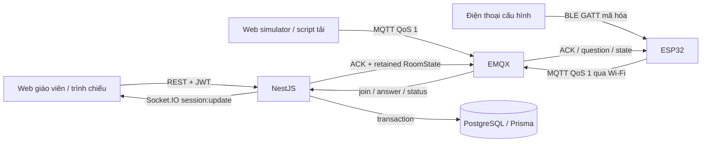
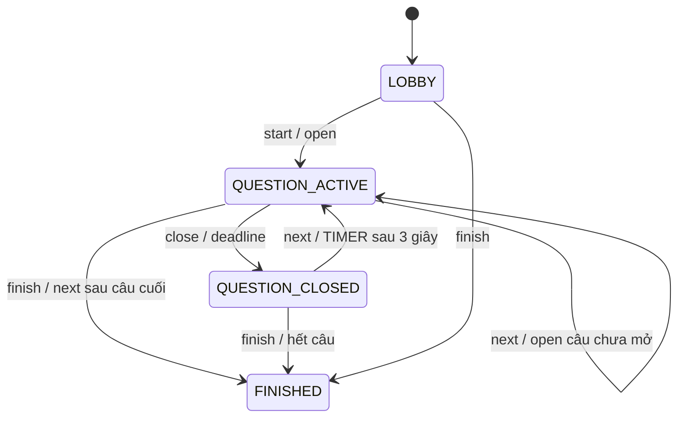

# Kiến trúc ClassPulse MVP

ClassPulse dùng một backend NestJS làm nguồn dữ liệu nghiệp vụ duy nhất. Web giáo viên điều khiển qua REST và nhận snapshot qua Socket.IO; thiết bị gửi join/answer/status qua EMQX. PostgreSQL giữ trạng thái phiên, deadline, participant, đáp án hiện hành và kết quả xử lý MQTT.

Web giáo viên không kết nối MQTT. Route `/device-simulator` là client thiết bị riêng: dùng MQTT over WebSocket với tài khoản giới hạn quyền và không gọi API để nộp đáp án. Route trình chiếu vẫn cần đăng nhập bằng tài khoản sở hữu phiên; không có đường dẫn công khai bỏ qua xác thực.

## Bố cục mã nguồn

| Đường dẫn | Trách nhiệm |
|---|---|
| `apps/backend/src/auth.ts`, `dto.ts`, `http.ts` | Tài khoản, xác thực, validation, lỗi, rate limit và health |
| `apps/backend/src/quizzes.ts` | Quiz/câu hỏi thuộc từng giáo viên; xóa mềm; kiểm tra khóa đáp án theo loại câu |
| `apps/backend/src/extract.ts`, `imports.ts` | Đọc Word (XML gốc, giữ định dạng đánh dấu đáp án), PDF (unpdf), Excel/CSV; nhập câu hỏi, file mẫu, nhận dạng bằng AI |
| `apps/backend/src/ai.ts`, `ai-providers.ts` | Chọn nguồn AI (Gemini, Ollama, Claude), structured output qua streaming theo JSON Schema, hàng đợi AiJob chạy nền |
| `apps/backend/src/sections.ts`, `generation.ts` | Tách chương tài liệu, tạo câu hỏi theo lô và tỷ lệ độ khó, hàng chờ duyệt |
| `apps/backend/src/bank.ts`, `quality.ts`, `analytics.ts` | Ngân hàng câu hỏi/trùng lặp, đánh giá chất lượng đề, phân tích kết quả và nhận xét AI |
| `apps/backend/src/classes.ts`, `exams.ts` | Lớp học/danh sách sinh viên, kỳ thi, mã đề, đề in, thống kê điểm theo lớp |
| `apps/backend/src/sessions.ts` | Snapshot, máy trạng thái, deadline, điều khiển và khôi phục timer |
| `apps/backend/src/mqtt.ts` | Subscriber, validation, transaction, idempotency, ACK và retained state |
| `apps/backend/src/events.ts`, `realtime.ts` | Tuần tự hóa broadcast từng phiên và Socket.IO |
| `apps/backend/prisma` | Schema, migration, seed |
| `apps/frontend` | React 18 + TypeScript + Vite + Tailwind, giao diện giáo viên/trình chiếu |
| `apps/device-simulator` | Component React dùng mqtt.js, keypad vật lý và LED 7 đoạn |
| `apps/firmware` | ESP-IDF: keypad, hai display 74HC595, LED trạng thái, BLE provisioning, Wi-Fi, MQTT QoS 1, ACK/retry/NVS |
| `packages/shared-types` | Kiểu API, khóa đáp án nhiều lựa chọn, thống kê, trình đọc câu hỏi dạng văn bản, so khớp trùng lặp, phân tích câu hỏi, sinh mã đề |
| `packages/mqtt-contracts` | Topic v1, Zod schemas, ACK và RoomState |
| `scripts/simulate-devices` | Tải nhiều thiết bị qua MQTT thật |
| `infra`, `docker-compose.yml` | Image, proxy Nginx, auth/ACL EMQX và persistent volumes |

## Dữ liệu và các bất biến

| Bảng | Vai trò / ràng buộc |
|---|---|
| `Teacher` | Email unique; chỉ lưu bcrypt password hash |
| `RefreshToken` | SHA-256 token hash unique, familyId, thời hạn và revokedAt |
| `Quiz`, `Question` | Tài liệu gốc thuộc giáo viên; deletedAt để không làm mất lịch sử |
| `QuizSession` | Chủ sở hữu, mã phòng, trạng thái, mode, deadline và chỉ số câu hiện tại |
| `SessionQuestion` | Bản sao nội dung/đáp án khi tạo phiên, unique `(sessionId, order)` |
| `Device` | deviceId, online, lastSeenAt |
| `SessionParticipant` | Unique `(sessionId, deviceId)` và `(sessionId, studentCode)` |
| `Answer` | Một đáp án hiện hành cho `(participantId, questionId)`, sequence, timestamp client/server |
| `ProcessedMqttMessage` | requestId UUID primary key, deviceId/action, hash payload và ACK đã xử lý |
| `SourceDocument` | Tài liệu nguồn cho AI: văn bản đã trích, danh sách chương; giữ file gốc chỉ với PDF scan |
| `AiJob` | Tác vụ AI: loại, trạng thái, tiến độ, input/result JSON, số token |
| `GeneratedQuestion` | Câu AI đề xuất chờ duyệt (PENDING/APPROVED/REJECTED) và câu hỏi đã tạo khi duyệt |
| `Classroom`, `Student` | Lớp của giáo viên; mã thiết bị 2 chữ số unique trong lớp |
| `Exam`, `ExamQuestion`, `ExamVariant` | Kỳ thi, bản sao câu hỏi lúc tạo kỳ thi, thứ tự câu/phương án của từng mã đề |

Migration SQL bổ sung partial unique index cho `roomCode` khi status khác `FINISHED`; mã chỉ được tái sử dụng sau khi phiên trước kết thúc. Có CHECK mã phòng 6 số, thời gian câu hỏi 5–3600 giây và sequence dương. Không thay migration bằng `prisma db push`, vì partial index/SQL constraints là một phần bảo đảm dữ liệu.

`correctAnswer` (Question, SessionQuestion, ExamQuestion) và `Answer.answer` là khóa chuẩn A–D theo thứ tự chữ cái (`B`, `AC`); CHECK constraint bảo đảm khóa hợp lệ và câu `SINGLE` chỉ có một chữ. Câu nhiều đáp án chấm kiểu đúng-tất-cả: so sánh nguyên khóa.

Session sao chép quiz thành `SessionQuestion` với UUID mới. Vì thế sửa/xóa quiz không thay đổi câu đã dùng trong phiên và báo cáo cũ. `questionId` trong MQTT là UUID của **SessionQuestion**, lấy từ snapshot, không phải UUID của Question gốc. Một câu đã mở không được mở lại trong cùng phiên; tạo phiên mới nếu muốn làm lại bài.

Đáp án hợp lệ mới cập nhật bản ghi Answer hiện hành; thống kê không cộng các lần đổi đáp án. ProcessedMqttMessage giữ dấu vết request, hash và ACK nhưng không lưu toàn bộ nội dung các phiên bản đáp án. MVP chưa có bảng audit đầy đủ cho từng lần đổi lựa chọn.

## Luồng ghi MQTT và xử lý đồng thời

1. Subscriber nhận topic chính xác `quiz/v1/devices/{id}/join|answer|status`. Topic ngoài mẫu bị bỏ qua; payload trên 8192 byte, JSON sai hoặc schema sai bị từ chối.
2. Zod kiểm tra các trường, UUID, mã phòng, enum, sequence; deviceId trong payload phải khớp topic. ACL broker đã giới hạn topic theo danh tính trước khi message tới subscriber.
3. Trong transaction PostgreSQL, khóa advisory theo hash của requestId trước khi đọc ProcessedMqttMessage. Hai bản gửi QoS 1 cùng lúc vì vậy không cùng áp dụng thao tác.
4. Nếu requestId tồn tại, so khớp deviceId, action và SHA-256 của payload chuẩn hóa thứ tự trường. Payload khác dùng lại requestId trả `INVALID_PAYLOAD`. Payload giống trả `DUPLICATE_MESSAGE` với `success` và `originalCode` của lần đầu.
5. Khóa hàng QuizSession bằng `SELECT ... FOR UPDATE`, đọc lại trạng thái rồi mới lấy thời gian server. Khóa này cũng được dùng bởi thao tác giáo viên và timer, tránh answer chạy đua với đóng/chuyển câu.
6. Join kiểm tra ánh xạ thiết bị/sinh viên. Answer kiểm tra participant, trạng thái, questionId, deadline và sequence lớn hơn đáp án hiện hành. Ghi Answer cùng bản ghi ProcessedMqttMessage/ACK trong một transaction.
7. Sau commit mới gửi ACK ứng dụng QoS 1 và phát sự kiện cập nhật. HTTP/PUBACK của broker không đồng nghĩa đáp án đã được lưu; thiết bị chờ ACK ứng dụng theo requestId.

Giới hạn chờ/transaction của xử lý MQTT là 15 giây. ACK `SERVER_ERROR` được trả khi pipeline gặp lỗi và không coi đó là kết quả đã commit. Retry cùng requestId khôi phục kết quả nếu backend đã commit nhưng mất ACK. Bản tin cũ có sequence thấp hơn không ghi đè lựa chọn mới.

## Timer, reload và khởi động lại

Server lưu `questionStartedAt`, `questionEndsAt`, `nextQuestionAt`. Khi mở câu, deadline = thời gian server hiện tại + thời lượng override của session hoặc thời lượng câu. Đổi thời lượng trong settings chỉ áp dụng cho câu mở sau đó, không sửa deadline đang chạy.

Vòng quét mỗi **250 ms**, có chặn tick chồng nhau, tìm phiên đã tới deadline và khóa/đọc lại trước khi chuyển trạng thái. Cả MANUAL lẫn TIMER đều đóng nhận đáp án khi hết giờ. MANUAL chờ giáo viên next; TIMER đặt `nextQuestionAt` bằng thời điểm đóng + **3 giây**, rồi mở câu tiếp hoặc finish.

Backend gọi một tick ngay khi khởi động. Nếu đã quá giờ trong lúc backend dừng, câu đang mở được đóng khi phục hồi; TIMER vẫn dành 3 giây công bố kết quả tính từ lúc đóng được phục hồi, không tua qua toàn bộ các câu bị bỏ lỡ. Đáp án đến sau deadline vẫn bị từ chối ngay trong transaction, kể cả tick chưa kịp đổi trạng thái.

Web reload lấy lại snapshot REST, join Socket.IO rồi nhận snapshot mới. Countdown được tính từ `questionEndsAt` và `serverTime`, sau đó nội suy bằng đồng hồ đơn điệu trong trình duyệt. Countdown chỉ phục vụ hiển thị; browser không quyết định quyền nộp bài. Khi mất Socket, web còn tải lại REST định kỳ 5 giây nếu tab đang hiển thị. Khi broker kết nối lại, backend subscribe lại và phát retained snapshot cho các phiên chưa kết thúc.

## Snapshot, thống kê và bảo vệ đáp án

Snapshot được đọc trong transaction `RepeatableRead` để câu hỏi, participant và answer nhất quán. Các broadcast của cùng một session nối tiếp nhau trong SessionEvents; frontend bỏ snapshot có `serverTime` cũ hơn bản đã nhận.

Khi `QUESTION_ACTIVE`, currentQuestion không có `correctAnswer`; participant chỉ có `answered`, không có `answer`/`isCorrect`. Tổng số và phân phối A/B/C/D vẫn có để giáo viên quan sát. Các chỉ số đúng/sai lúc này bằng 0 vì đáp án chưa được công bố. Sau đóng câu/finish, các trường đáp án được trả; `results` chứa các câu đã có closedAt.

Phần trăm A/B/C/D và đúng/sai lấy số **đã trả lời** làm mẫu số, làm tròn 2 chữ số. Khi chưa có đáp án, mọi phần trăm bằng 0. `unanswered = max(0, participantCount - answered)`. Participant mới join giữa phiên được tính trong tổng participant hiện tại, kể cả khi xem thống kê các câu trước.

## Xác thực HTTP và realtime

- Mật khẩu bcrypt cost 12; đăng ký yêu cầu 8–72 ký tự và tối đa 72 byte UTF-8.
- JWT access token HS256, hạn 15 phút; khóa `JWT_ACCESS_SECRET` tối thiểu 32 ký tự. Web giữ access token trong bộ nhớ, không localStorage.
- Refresh token ngẫu nhiên 48 byte, hạn 7 ngày; database chỉ lưu SHA-256 hash. Cookie `refreshToken` có HttpOnly, SameSite=Lax, Path=/api/auth; Secure theo `COOKIE_SECURE`.
- Refresh xoay token và revoke token cũ bằng compare-and-set. Khi phát hiện token đã revoke/hết hạn, revoke các refresh token còn hoạt động trong cùng family. Logout revoke refresh token hiện tại; JWT đã phát hành tồn tại tới khi hết hạn.
- API của quiz/session luôn lọc theo teacherId đã xác thực; tài nguyên của người khác trả 404. Socket xác thực access token, kiểm tra quyền sở hữu khi join session và ngắt kết nối khi JWT hết hạn.
- CORS theo `FRONTEND_ORIGIN` (danh sách cách nhau bằng dấu phẩy). Request thay đổi từ Origin ngoài danh sách bị từ chối; client không gửi Origin vẫn cần token tương ứng.
- Rate limit theo IP trong bộ nhớ: login/register chung 20 request/phút, API còn lại 600/phút theo mặc định. Có `AUTH_RATE_LIMIT`, `API_RATE_LIMIT`; chỉ bật `TRUST_PROXY` khi có proxy tin cậy.
- HTTP log có requestId/method/path/status/duration; không log request body, password hoặc token. Exception filter không gửi stack/SQL cho client.

## MQTT auth, provisioning và phần cứng

EMQX dùng authentication database có mật khẩu và ACL mặc định deny; anonymous bị từ chối. Backend có credential riêng với quyền subscribe đầu vào thiết bị/publish đầu ra. Simulator phát triển dùng credential chia sẻ và topic ràng buộc `${clientid}`; thông tin quản trị EMQX không nằm trong bundle web.

Credential chia sẻ không bảo vệ khỏi việc giả mạo clientId bởi người đã biết mật khẩu. Production dùng `pnpm provision --deviceId=device-001` với `MQTT_DEVICE_PASSWORD` riêng. ACL tài khoản `device-*` ràng buộc topic theo `${username}` đã xác thực; đổi clientId không cấp quyền truy cập thiết bị khác. Tắt credential chia sẻ bằng `MQTT_SIMULATOR_ENABLED=false`. Quyền đọc room state hiện còn dùng `rooms/+`; nếu nội dung lớp cần bảo mật, cần authorization theo phòng. Chi tiết payload/provisioning: [mqtt-protocol.md](mqtt-protocol.md).

Firmware tham chiếu ESP-IDF hỗ trợ ESP32/ESP32-S, Wi-Fi, keypad 4×4 gồm 0–9, A–D, Xóa, Confirm, hai module LED bốn số dùng 74HC595 và hai LED trạng thái. Hai display tạo vùng tám ký tự, dùng chung SCLK/RCLK và có DIO riêng; task keypad có debounce ba mẫu. BLE GATT dùng cho provisioning cục bộ, sau đó dữ liệu quiz đi qua Wi-Fi/MQTT. Wi-Fi modem-sleep và automatic light-sleep duy trì kết nối khi display tắt sau 5 giây. Mã sinh viên trên keypad nhập dạng số; backend vẫn hỗ trợ mã chữ/số. Pinout và mạch thật chưa được xác minh trên PCB; biểu tượng Wi-Fi của web simulator chỉ dùng `navigator.onLine`.

## Vận hành và giới hạn triển khai

Compose khai báo PostgreSQL 17.6, EMQX 5.8.8, bước tạo broker config, backend và frontend/Nginx; simulator nằm trong frontend nên không cần service riêng. Postgres/broker có volume bền vững. Backend đợi health của database/broker; frontend đợi backend. Nginx phục vụ SPA, proxy `/api/`, `/socket.io/`, `/mqtt`; cổng backend/broker/database mặc định chỉ bind localhost, frontend rootless bind `127.0.0.1:8080`. Trình cài localhost dùng Apache đang có sẵn hoặc socket proxy systemd khi cổng 80 còn trống, cho phép dùng `http://localhost` mà không nới quyền bind cổng đặc quyền cho mọi tiến trình người dùng. `localhost` trong cấu hình trình duyệt là máy người dùng, nên triển khai từ xa cần thay hostname và dùng HTTPS/WSS/TLS.

Ứng dụng hiện thiết kế cho **một instance backend**: hàng đợi broadcast, rate limit và Socket.IO room nằm trong bộ nhớ; MQTT clientId backend cố định. PostgreSQL locks bảo vệ ghi nhưng chưa đủ để biến toàn hệ thống thành multi-instance. Khi mở rộng cần event/outbox bền vững, Socket.IO adapter dùng chung, rate limiter dùng chung và chiến lược consumer MQTT/timer phù hợp. Sau crash giữa commit và broadcast, client có thể cần tải lại snapshot; MVP chưa có transactional outbox bảo đảm giao sự kiện.

Shutdown NestJS dừng timer, ngừng nhận MQTT mới, chờ tác vụ MQTT đang chạy rồi đóng client và Prisma. Health `/api/health` kiểm tra API, `SELECT 1` và trạng thái kết nối MQTT; khi thiếu một dependency bắt buộc trả 503.

Môi trường thực thi hiện tại không có Docker nên không có bằng chứng đã chạy Compose/container. Các kiểm thử runtime sử dụng PostgreSQL 18 và EMQX 5.8.8 chạy native. Cấu hình Compose là đường triển khai cung cấp trong repo; xem README/báo cáo kiểm thử để phân biệt kiểm thử đã chạy và phần còn cần xác nhận trên máy có Docker.

## Nhập file, AI và kỳ thi

- **Nhập câu hỏi** không lưu gì: backend trả bản nháp kèm cảnh báo, editor đánh dấu câu thiếu dữ liệu và chỉ lưu khi giáo viên bấm Lưu. File Office được kiểm tra kích thước giải nén trước khi mở (chống zip bomb); tối đa 20 MB, 500 trang PDF.
- **Tác vụ AI** (tạo câu hỏi, nhận dạng tài liệu, đánh giá đề, phân tích kết quả) chạy nền trong `AiJobsService`, tối đa 2 tác vụ đồng thời (AI_MAX_CONCURRENT_JOBS) và 3 tác vụ chưa xong mỗi giáo viên. Web poll `GET /ai/jobs/:id`, nên không phụ thuộc timeout proxy. Mỗi lời gọi dùng structured output: Zod schema được chuyển thành JSON Schema (`responseJsonSchema` với Gemini, `format` với Ollama, output format với Claude), rồi kết quả được kiểm tra lại bằng Zod; các trường dạng liệt kê được chuẩn hóa ở backend để một giá trị lạ không làm hỏng cả tác vụ. Gemini tự thử lại khi gặp 429/5xx (hạn mức theo phút của gói miễn phí). Khi cấu hình cả Gemini/Claude lẫn `OLLAMA_URL`, lời gọi gặp hết hạn mức, quá tải hoặc mất mạng được chuyển sang Ollama và nguồn chính được nghỉ 10 phút; `AiJob.model` ghi lại mô hình thực sự đã trả lời (ví dụ `gemini-3.8-flash + qwen3:4b-instruct`). Tài liệu nguồn được đánh dấu để Claude đọc từ prompt cache ở các lô sau; Ollama nhận JSON Schema cả trong prompt, giới hạn độ dài theo `OLLAMA_NUM_CTX` (tài liệu nhận dạng được chia nhỏ theo ngữ cảnh) và từ chối nội dung quá dài thay vì để mô hình cắt bớt. Kế hoạch tạo câu liệt kê từng câu (độ khó, loại, vị trí đáp án đúng được chia đều A–D) để mô hình nhỏ cũng bám đúng tỷ lệ.
- **Câu AI đề xuất** nằm trong `GeneratedQuestion` cho tới khi giáo viên duyệt; duyệt sao chép sang `Question` (origin `AI`) trong một transaction.
- **Trộn đề/xáo trộn đáp án**: `SessionQuestion.optionOrder` (ví dụ `CADB`) ghi phương án gốc ở từng vị trí hiển thị. Khóa đúng, nội dung phương án và tham chiếu "đáp án X" trong lời giải được quy đổi khi tạo phiên; phân tích kết quả quy đổi ngược về phương án gốc. Mã đề của kỳ thi sinh bằng PRNG có seed (ID kỳ thi + mã đề) nên tái lập được; câu có phương án phụ thuộc vị trí không bị đảo phương án.
- Thiết bị vẫn theo một câu chung trên màn chiếu tại một thời điểm. Mã đề giúp mỗi lớp/buổi có thứ tự câu và đáp án khác nhau, và in được đề giấy theo từng mã.
