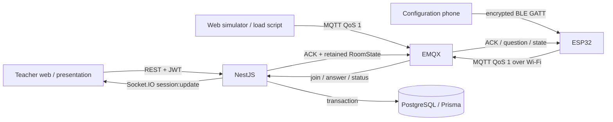
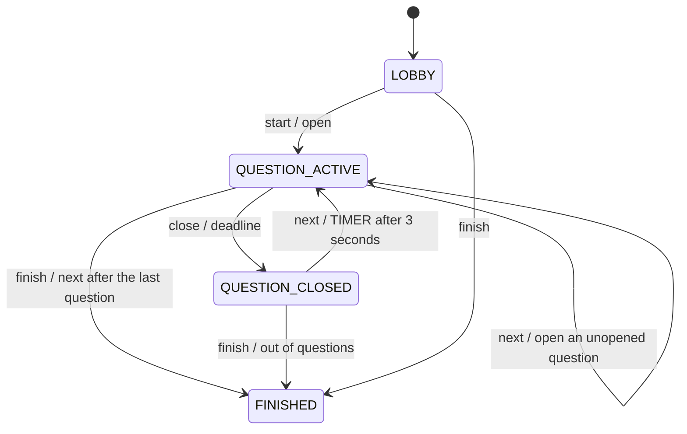

# ClassPulse MVP architecture

ClassPulse uses a single NestJS backend as the only source of business data. The teacher web app controls it through REST and receives snapshots through Socket.IO; devices send join/answer/status through EMQX. PostgreSQL holds the session state, the deadlines, the participants, the current answers and the results of MQTT processing.

The teacher web app does not connect to MQTT. The `/device-simulator` route is a separate device client: it uses MQTT over WebSocket with a permission-limited account and does not call the API to submit answers. The presentation route still requires logging in with the account that owns the session; there is no public path that skips authentication.

## Source layout

| Path | Responsibility |
|---|---|
| `apps/backend/src/auth.ts`, `dto.ts`, `http.ts` | Accounts, authentication, validation, errors, rate limiting and health |
| `apps/backend/src/quizzes.ts` | Each teacher's quizzes/questions; soft delete; checking the answer key by question type |
| `apps/backend/src/extract.ts`, `imports.ts` | Reading Word (raw XML, keeping the formatting that marks answers), PDF (unpdf), Excel/CSV; question import, sample files, AI recognition |
| `apps/backend/src/ai.ts`, `ai-providers.ts` | Choosing the AI source (Gemini, Ollama, Claude), structured output through streaming with a JSON Schema, a background AiJob queue |
| `apps/backend/src/sections.ts`, `generation.ts` | Splitting a document into chapters, generating questions in batches by difficulty ratio, the pending-review queue |
| `apps/backend/src/bank.ts`, `quality.ts`, `analytics.ts` | The question bank/duplicates, paper quality review, result analysis and AI commentary |
| `apps/backend/src/classes.ts`, `exams.ts` | Classes/student lists, exams, paper codes, printed papers, per-class score statistics |
| `apps/backend/src/sessions.ts` | Snapshots, the state machine, deadlines, control and timer recovery |
| `apps/backend/src/mqtt.ts` | Subscriber, validation, transactions, idempotency, ACK and retained state |
| `apps/backend/src/events.ts`, `realtime.ts` | Serialising the broadcasts of each session, and Socket.IO |
| `apps/backend/prisma` | Schema, migrations, seed |
| `apps/frontend` | React 18 + TypeScript + Vite + Tailwind, the teacher/presentation interface |
| `apps/device-simulator` | A React component using mqtt.js, a physical keypad and 7-segment LEDs |
| `apps/firmware` | ESP-IDF: keypad, two 74HC595 displays, status LEDs, BLE provisioning, Wi-Fi, MQTT QoS 1, ACK/retry/NVS |
| `packages/shared-types` | API types, multi-choice answer keys, statistics, the text question reader, duplicate matching, question analysis, paper code generation |
| `packages/mqtt-contracts` | v1 topics, Zod schemas, ACK and RoomState |
| `scripts/simulate-devices` | Load from many devices through a real MQTT broker |
| `infra`, `docker-compose.yml` | Images, the Nginx proxy, EMQX auth/ACL and persistent volumes |

## Data and invariants

| Table | Role / constraints |
|---|---|
| `Teacher` | Unique email; stores only a bcrypt password hash |
| `RefreshToken` | Unique SHA-256 token hash, familyId, expiry and revokedAt |
| `Quiz`, `Question` | The teacher's original documents; deletedAt so history is not lost |
| `QuizSession` | Owner, room code, state, mode, deadlines and the current question index |
| `SessionQuestion` | A copy of the content/answers made when the session is created, unique `(sessionId, order)` |
| `Device` | deviceId, online, lastSeenAt |
| `SessionParticipant` | Unique `(sessionId, deviceId)` and `(sessionId, studentCode)` |
| `Answer` | One current answer per `(participantId, questionId)`, sequence, client/server timestamps |
| `ProcessedMqttMessage` | requestId UUID primary key, deviceId/action, the payload hash and the ACK that was processed |
| `SourceDocument` | The source document for the AI: the extracted text and the list of chapters; the original file is kept only for scanned PDFs |
| `AiJob` | An AI task: kind, state, progress, input/result JSON, token counts |
| `GeneratedQuestion` | A question proposed by the AI and waiting for review (PENDING/APPROVED/REJECTED), plus the question created on approval |
| `Classroom`, `Student` | A teacher's class; a 2-digit device code that is unique within the class |
| `Exam`, `ExamQuestion`, `ExamVariant` | An exam, the copy of the questions made when the exam was created, and the order of questions/options for each paper code |

The SQL migration adds a partial unique index on `roomCode` when the status is not `FINISHED`; a code can only be reused after the previous session has finished. There are CHECK constraints for a 6-digit room code, a question time of 5–3600 seconds and a positive sequence. Do not replace the migrations with `prisma db push`, because the partial index/SQL constraints are part of the data guarantees.

`correctAnswer` (Question, SessionQuestion, ExamQuestion) and `Answer.answer` are canonical A–D keys in alphabetical order (`B`, `AC`); a CHECK constraint ensures the key is valid and that a `SINGLE` question has only one letter. A multiple-answer question is graded all-or-nothing: the whole key is compared.

A session copies the quiz into `SessionQuestion` rows with new UUIDs. Editing or deleting the quiz therefore does not change questions already used in a session or old reports. The `questionId` in MQTT is the UUID of the **SessionQuestion**, taken from the snapshot, not the UUID of the original Question. A question that has been opened cannot be opened again in the same session; create a new session to do the exercise again.

A valid answer only updates the current Answer record; the statistics do not add up changes of answer. ProcessedMqttMessage keeps a trace of the request, the hash and the ACK but does not store the full content of every version of an answer. The MVP has no full audit table for each change of choice.

## The MQTT write path and concurrency

1. The subscriber receives the exact topics `quiz/v1/devices/{id}/join|answer|status`. Topics outside the pattern are ignored; a payload over 8192 bytes, invalid JSON or an invalid schema is rejected.
2. Zod checks the fields, UUIDs, the room code, enums and the sequence; the deviceId in the payload must match the topic. The broker ACL has already limited the topics by identity before a message reaches the subscriber.
3. Inside a PostgreSQL transaction, an advisory lock on the hash of the requestId is taken before ProcessedMqttMessage is read. Two QoS 1 deliveries at the same moment therefore never apply the operation twice.
4. If the requestId exists, the deviceId, the action and the SHA-256 of the field-order-normalised payload are compared. A different payload reusing the requestId returns `INVALID_PAYLOAD`. An identical payload returns `DUPLICATE_MESSAGE` with the `success` and `originalCode` of the first time.
5. The QuizSession row is locked with `SELECT ... FOR UPDATE`, the state is read again and only then is the server time taken. The same lock is used by teacher actions and the timer, so an answer cannot race with closing or advancing a question.
6. Join checks the device/student mapping. Answer checks the participant, the state, the questionId, the deadline and that the sequence is greater than the current answer's. The Answer and the ProcessedMqttMessage/ACK record are written in one transaction.
7. Only after the commit is the QoS 1 application ACK sent and the update event emitted. The broker's HTTP/PUBACK does not mean the answer was stored; the device waits for the application ACK by requestId.

The wait/transaction limit of MQTT processing is 15 seconds. A `SERVER_ERROR` ACK is returned when the pipeline fails, and it is not treated as a committed result. A retry with the same requestId recovers the result if the backend committed but lost the ACK. An old message with a lower sequence does not overwrite a newer choice.

## Timer, reload and restart

The server stores `questionStartedAt`, `questionEndsAt` and `nextQuestionAt`. When a question opens, deadline = current server time + the session's override duration or the question's duration. Changing the duration in settings only applies to questions opened afterwards and does not edit a running deadline.

A sweep runs every **250 ms**, with protection against overlapping ticks; it finds sessions that reached their deadline and locks/rereads before changing state. Both MANUAL and TIMER stop accepting answers when time is up. MANUAL waits for the teacher to press next; TIMER sets `nextQuestionAt` to the closing time + **3 seconds**, then opens the next question or finishes.

The backend runs one tick immediately at startup. If the deadline passed while the backend was down, the open question is closed on recovery; TIMER still gives 3 seconds to show the result counted from the recovered closing time, and does not fast-forward through all the questions that were missed. An answer that arrives after the deadline is still rejected inside the transaction, even if the tick has not yet changed the state.

When the web app reloads it fetches the REST snapshot again, joins Socket.IO and then receives a new snapshot. The countdown is computed from `questionEndsAt` and `serverTime`, then interpolated with the browser's monotonic clock. The countdown is for display only; the browser does not decide whether a submission is allowed. When the socket is down the web app also reloads REST periodically every 5 seconds while the tab is visible. When the broker reconnects, the backend subscribes again and republishes the retained snapshot for sessions that have not finished.

## Snapshots, statistics and answer protection

A snapshot is read inside a `RepeatableRead` transaction so the question, participants and answers are consistent. Broadcasts for the same session run one after another in SessionEvents; the frontend drops a snapshot whose `serverTime` is older than the one it already received.

While `QUESTION_ACTIVE`, currentQuestion has no `correctAnswer`; a participant only has `answered`, with no `answer`/`isCorrect`. The totals and the A/B/C/D distribution are still present so the teacher can watch. The correct/incorrect figures are 0 at this point because the answer has not been published. After the question closes/finish, the answer fields are returned; `results` contains the questions that have a closedAt.

The A/B/C/D and correct/incorrect percentages use the number **answered** as the denominator, rounded to 2 digits. With no answers, every percentage is 0. `unanswered = max(0, participantCount - answered)`. A participant who joins mid-session counts in the current participant total, even when viewing the statistics of earlier questions.

## HTTP and realtime authentication

- Passwords use bcrypt at cost 12; registration requires 8–72 characters and at most 72 UTF-8 bytes.
- The JWT access token is HS256 and valid for 15 minutes; the key `JWT_ACCESS_SECRET` needs at least 32 characters. The web app keeps the access token in memory, not in localStorage.
- The refresh token is 48 random bytes valid for 7 days; the database only stores its SHA-256 hash. The `refreshToken` cookie is HttpOnly, SameSite=Lax, Path=/api/auth; Secure follows `COOKIE_SECURE`.
- A refresh rotates the token and revokes the old one with compare-and-set. When a revoked/expired token is detected, the other active refresh tokens in the same family are revoked. Logout revokes the current refresh token; an already issued JWT lives until it expires.
- The quiz/session API always filters by the authenticated teacherId; another person's resource returns 404. The socket authenticates the access token, checks ownership when joining a session and disconnects when the JWT expires.
- CORS follows `FRONTEND_ORIGIN` (a comma-separated list). A state-changing request from an Origin outside the list is rejected; a client that sends no Origin still needs the corresponding token.
- The rate limit is per IP in memory: login/register share 20 requests per minute and the rest of the API 600 per minute by default. `AUTH_RATE_LIMIT` and `API_RATE_LIMIT` exist; only turn on `TRUST_PROXY` when there is a trusted proxy.
- The HTTP log has requestId/method/path/status/duration; it does not log the request body, passwords or tokens. The exception filter does not send stacks/SQL to clients.

## MQTT auth, provisioning and hardware

EMQX uses a password-based authentication database and a default-deny ACL; anonymous access is refused. The backend has its own credential with permission to subscribe to the device inputs and publish the outputs. The development simulator uses a shared credential and topics bound to `${clientid}`; the EMQX admin credentials are not in the web bundle.

A shared credential does not protect against someone who knows the password forging a clientId. Production uses `pnpm provision --deviceId=device-001` with a separate `MQTT_DEVICE_PASSWORD`. The ACL of `device-*` accounts binds the topics to the authenticated `${username}`; changing the clientId does not grant access to another device. Turn off the shared credential with `MQTT_SIMULATOR_ENABLED=false`. Permission to read the room state still uses `rooms/+`; if the class content needs to be confidential, per-room authorization is required. Payload/provisioning details: [mqtt-protocol.md](mqtt-protocol.md).

The reference ESP-IDF firmware supports ESP32/ESP32-S, Wi-Fi, a 4×4 keypad with 0–9, A–D, Clear and Confirm, two four-digit LED modules driven by 74HC595s and two status LEDs. The two displays form an eight-character area, share SCLK/RCLK and have separate DIO lines; the keypad task has three-sample debouncing. BLE GATT is used for local provisioning, after which the quiz data travels over Wi-Fi/MQTT. Wi-Fi modem-sleep and automatic light-sleep keep the connection while the display turns off after 5 seconds. The student code on the keypad is entered as digits; the backend still supports alphanumeric codes. The pinout and the real circuit have not been verified on a PCB; the Wi-Fi icon of the web simulator only uses `navigator.onLine`.

## Operation and deployment limits

Compose declares PostgreSQL 17.6, EMQX 5.8.8, a step that creates the broker config, the backend and the frontend/Nginx; the simulator is inside the frontend so it needs no service of its own. Postgres and the broker have persistent volumes. The backend waits for the database/broker health; the frontend waits for the backend. Nginx serves the SPA and proxies `/api/`, `/socket.io/` and `/mqtt`; the backend/broker/database ports bind to localhost by default, and the rootless frontend binds `127.0.0.1:8080`. The localhost installer uses an Apache that is already present, or a systemd socket proxy when port 80 is free, which makes `http://localhost` usable without loosening the privileged-port bind permission for every user process. `localhost` in the browser configuration is the user's own machine, so a remote deployment must change the hostname and use HTTPS/WSS/TLS.

The application is currently designed for **one backend instance**: the broadcast queue, the rate limit and the Socket.IO rooms live in memory; the backend's MQTT clientId is fixed. PostgreSQL locks protect writes but are not enough to make the whole system multi-instance. Scaling out needs a durable event/outbox, a shared Socket.IO adapter, a shared rate limiter and a suitable MQTT consumer/timer strategy. After a crash between the commit and the broadcast, clients may need to reload the snapshot; the MVP has no transactional outbox guaranteeing event delivery.

NestJS shutdown stops the timer, stops accepting new MQTT messages, waits for running MQTT work and then closes the client and Prisma. The `/api/health` health check checks the API, `SELECT 1` and the MQTT connection state; when a required dependency is missing it returns 503.

The current execution environment has no Docker, so there is no evidence that Compose/containers were run. The runtime tests use PostgreSQL 18 and EMQX 5.8.8 running natively. The Compose configuration is the deployment path provided in the repository; see the README/test report to tell apart the tests that were run from the parts that still need confirming on a machine with Docker.

## File import, AI and exams

- **Question import** stores nothing: the backend returns a draft with warnings, the editor marks questions with missing data and only saves when the teacher presses Save. Office files have their uncompressed size checked before they are opened (zip-bomb protection); at most 20 MB and 500 PDF pages.
- **AI tasks** (question generation, document recognition, paper review, result analysis) run in the background in `AiJobsService`, with at most 2 at the same time (AI_MAX_CONCURRENT_JOBS) and 3 unfinished tasks per teacher. The web app polls `GET /ai/jobs/:id`, so it does not depend on proxy timeouts. Each call uses structured output: a Zod schema is converted to a JSON Schema (`responseJsonSchema` for Gemini, `format` for Ollama, the output format for Claude), and the result is checked again with Zod; enumerated fields are normalised in the backend so one unexpected value does not break the whole task. Gemini retries by itself on 429/5xx (the per-minute quota of the free tier). When both Gemini/Claude and `OLLAMA_URL` are configured, a call that hits a quota, overload or lost connection is moved to Ollama and the primary source rests for 10 minutes; `AiJob.model` records the model that actually answered (for example `gemini-3.8-flash + qwen3:4b-instruct`). The source document is marked so Claude reads it from the prompt cache in later batches; Ollama receives the JSON Schema inside the prompt too, limits the length according to `OLLAMA_NUM_CTX` (a document being recognised is split by context) and rejects content that is too long instead of letting the model truncate it. The question-generation plan lists each question (difficulty, type, and the position of the correct answer spread evenly over A–D) so even a small model follows the ratios.
- **AI-proposed questions** stay in `GeneratedQuestion` until the teacher approves them; approving copies them to `Question` (origin `AI`) in one transaction.
- **Paper shuffle/option shuffle**: `SessionQuestion.optionOrder` (for example `CADB`) records the original option at each displayed position. The correct key, the option text and the "answer X" references in the explanation are converted when the session is created; result analysis converts back to the original options. An exam's paper codes are generated by a seeded PRNG (exam ID + paper code), so they are reproducible; a question whose options depend on position does not have its options swapped.
- Devices still follow one shared question on the presentation screen at a time. Paper codes give each class/session a different order of questions and answers, and let a paper exam be printed for each code.
