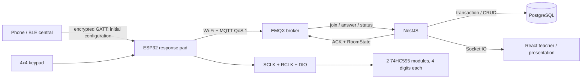

# Mapping ClassPulse to the IoT course material

The slides are used as technical reference material. The Apache/PHP/MySQL, BlueZ/RFCOMM and sensor examples in the lectures illustrate principles; they are not copied as operating instructions and do not replace ClassPulse's business requirements.

| Lecture topic | How ClassPulse implements it |
|---|---|
| IoT architecture: data collection → data transmission → processing/information → application | Keypad/ESP32 → Wi-Fi/MQTT/EMQX → NestJS/PostgreSQL → React/Socket.IO |
| Network model, client/server and sockets | The device is an MQTT client; EMQX is the broker; the backend is a subscriber/publisher; the web app uses HTTP and WebSocket through Nginx |
| BLE GAP/GATT/ATT, peripheral/central, service/characteristic | The ESP32 is a BLE peripheral while provisioning; the phone is the central; a dedicated service has an encrypted characteristic for writing the configuration and a characteristic for reading the state |
| Wi-Fi, TCP/IP and the HTTP/MQTT/WebSocket application layer | The ESP32 uses Wi-Fi STA + MQTT/TCP; the teacher uses REST/HTTP; presentation updates use Socket.IO/WebSocket |
| A web server receiving requests and returning responses | Nginx serves the SPA/proxy; NestJS receives REST requests, validates, authenticates and returns JSON, in place of the Apache/PHP sample in the slides |
| Relational database and CRUD | PostgreSQL + Prisma implement CRUD, unique/check/foreign keys, transactions and migrations; the device never writes to the database directly |
| MQTT publish/subscribe, broker, hierarchical topics, QoS | `quiz/v1/...` topics, EMQX, QoS 1, retained room state, wildcards only in subscribers/ACLs; the application ACK is separate from PUBACK |

## Why the current components were chosen

PostgreSQL replaces the MySQL/MariaDB of the lecture examples but keeps the same relational model, data types, CRUD and transactions. NestJS/Nginx replace Apache/PHP but keep the roles of web server/application server and request/response. These choices meet the technologies requested for the MVP and add validation, ownership, migrations and automated tests.

BLE is only used for configuration close to the device. The quiz data goes over Wi-Fi/MQTT because it needs many devices in one classroom, a central broker and asynchronous publish/subscribe. This split of roles also avoids putting the Wi-Fi/MQTT password in the firmware source or giving the device access to the database.

## The complete flow

## What has been verified and what needs hardware

The backend, frontend, MQTT contract, simulator and load test have automated tests in the repo. The firmware has host unit tests for input handling, display scrolling, the sequence and the device ID. The ESP-IDF build and electrical tests need an ESP32 board, two 74HC595 modules, a keypad and real status LEDs; the pinout and procedure are in [`apps/firmware/README.md`](../apps/firmware/README.md) and the circuit diagram is in [`docs/hardware/breadboard-wiring.md`](hardware/breadboard-wiring.md).
