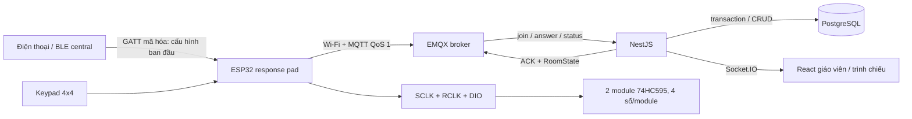

# Đối chiếu ClassPulse với tài liệu môn IoT

Các slide được dùng làm tài liệu kỹ thuật tham chiếu. Ví dụ Apache/PHP/MySQL, BlueZ/RFCOMM và cảm biến trong bài giảng minh họa nguyên lý; chúng không được sao chép thành chỉ dẫn vận hành hay thay thế yêu cầu nghiệp vụ ClassPulse.

| Nội dung bài giảng | Cách ClassPulse hiện thực |
|---|---|
| Kiến trúc IoT: thu thập dữ liệu → truyền dữ liệu → xử lý/thông tin → ứng dụng | Keypad/ESP32 → Wi-Fi/MQTT/EMQX → NestJS/PostgreSQL → React/Socket.IO |
| Mô hình mạng, client/server và socket | Thiết bị là MQTT client; EMQX là broker; backend là subscriber/publisher; web dùng HTTP và WebSocket qua Nginx |
| BLE GAP/GATT/ATT, peripheral/central, service/characteristic | ESP32 là BLE peripheral khi provision; điện thoại là central; service riêng có characteristic ghi cấu hình đã mã hóa và characteristic đọc trạng thái |
| Wi-Fi, TCP/IP và tầng ứng dụng HTTP/MQTT/WebSocket | ESP32 dùng Wi-Fi STA + MQTT/TCP; giáo viên dùng REST/HTTP; cập nhật trình chiếu dùng Socket.IO/WebSocket |
| Web server nhận request và trả response | Nginx phục vụ SPA/proxy; NestJS nhận REST request, validation, xác thực và trả JSON thay cho mẫu Apache/PHP trong slide |
| Database quan hệ và CRUD | PostgreSQL + Prisma hiện thực CRUD, unique/check/foreign key, transaction và migration; thiết bị không ghi database trực tiếp |
| MQTT publish/subscribe, broker, topic phân cấp, QoS | Topic `quiz/v1/...`, EMQX, QoS 1, retained room state, wildcard chỉ ở subscriber/ACL; ACK ứng dụng tách khỏi PUBACK |

## Lý do chọn các thành phần hiện tại

PostgreSQL thay MySQL/MariaDB trong ví dụ bài giảng nhưng giữ đúng mô hình quan hệ, kiểu dữ liệu, CRUD và transaction. NestJS/Nginx thay Apache/PHP nhưng giữ đúng vai trò web server/application server và request/response. Các lựa chọn này đáp ứng công nghệ đã yêu cầu cho MVP và bổ sung validation, ownership, migration cùng kiểm thử tự động.

BLE chỉ dùng cho cấu hình gần thiết bị. Dữ liệu quiz đi qua Wi-Fi/MQTT vì cần nhiều thiết bị trong một lớp, broker trung tâm và publish/subscribe bất đồng bộ. Cách phân vai này cũng tránh đưa mật khẩu Wi-Fi/MQTT vào firmware source hoặc cho thiết bị truy cập database.

## Luồng đầy đủ

## Phần đã kiểm chứng và phần cần phần cứng

Backend, frontend, MQTT contract, simulator và load test có kiểm thử tự động trong repo. Firmware có unit test host cho nhập liệu, cuộn display, sequence và device ID. Build ESP-IDF và kiểm thử điện cần board ESP32, hai module 74HC595, keypad và LED trạng thái thật; pinout và quy trình nằm tại [`apps/firmware/README.md`](../apps/firmware/README.md), sơ đồ mạch tại [`docs/hardware/breadboard-wiring.md`](hardware/breadboard-wiring.md).
