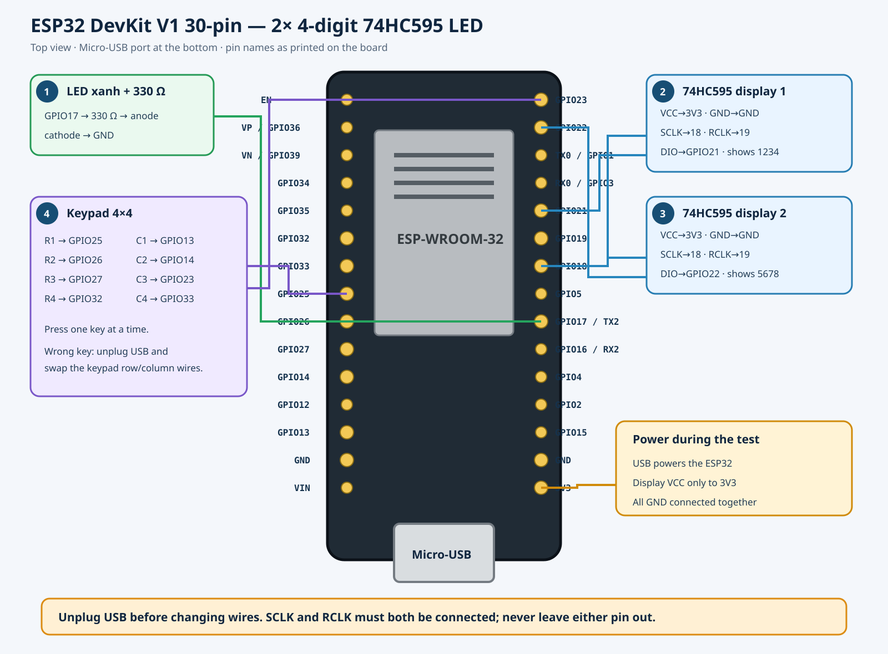

# ClassPulse pad — 30-pin ESP32 breadboard wiring



The close-up photo confirms that both modules have five pins `VCC`, `GND`, `DIO`, `SCLK`, `RCLK`, which is the four-digit LED type driven by a 74HC595. `SCLK` shifts each bit into the shift register; `RCLK` latches the data onto the LED outputs. Both signals are required.

If you only have one 330 Ω resistor and one green LED, use the [minimal test setup](minimal-test.md). The firmware has `CP_MINIMAL_BREADBOARD_TEST=1` enabled by default.

## Display connections

The two modules share the clock and latch but have their own data lines:

| Module pin | Display 1 | Display 2 |
|---|---|---|
| VCC | 3V3 | 3V3 |
| GND | GND | GND |
| SCLK | GPIO18 | GPIO18 |
| RCLK | GPIO19 | GPIO19 |
| DIO | GPIO21 | GPIO22 |

Wire by the labels printed on the PCB, not by the pin positions in the photo. On the current breadboard, power the displays from 3V3 so the ESP32 logic levels match directly. If a PCB version needs the displays at 5 V for more brightness, use a 74AHCT125 buffer on the four lines `SCLK`, `RCLK`, `DIO1`, `DIO2`.

## 4×4 keypad

The test profile uses the internal pull-downs:

| Keypad | ESP32 |
|---|---|
| R1–R4 | GPIO25, GPIO26, GPIO27, GPIO32 |
| C1–C4 | GPIO13, GPIO14, GPIO23, GPIO33 |

When `CP_MINIMAL_BREADBOARD_TEST` is changed to `0`, the columns use GPIO33/34/35/39 and each column needs a 47 kΩ resistor to GND; each row has a 1 kΩ series resistor. The order of the eight wires of a clone keypad is not guaranteed to be the same, so check continuity or try each key and then fix the wire order.

## Status LED

In the current test:

```text
GPIO17 → 330 Ω → green LED anode
LED cathode → GND
```

The test sketch uses a 250 ms green pulse for Wi-Fi online and one second for offline. With all the parts available, the complete circuit uses GPIO16 for the red LED and GPIO17 for the green LED, each with a 1 kΩ series resistor.

## Operating modes

- The two modules are multiplexed continuously; so the code refreshes the display about every 1 ms.
- A keypad press updates the content and the status LED.
- After 5 seconds without a press, the 74HC595 chain is latched to the display-off state.
- The system firmware uses Wi-Fi modem-sleep and automatic light-sleep to keep the MQTT connection.

## Test sequence

1. Connect only the ESP32 and the green LED; flash the sketch and check that the LED blinks at boot.
2. Unplug USB, connect display 1 and check `1234`.
3. Unplug USB, swap in display 2 and check `5678`.
4. Unplug USB, connect both displays together with SCLK/RCLK shared.
5. Unplug USB, connect the keypad last and press only one key at a time.

## References

- [Library and pin mapping of the 74HC595 module](https://github.com/DIYables/DIYables_4Digit7Segment_74HC595)
- [SN74HC595 datasheet](https://www.ti.com/lit/ds/symlink/sn74hc595.pdf)
- [ESP32 sleep modes](https://docs.espressif.com/projects/esp-idf/en/stable/esp32/api-reference/system/sleep_modes.html)
- [ESP32 hardware design guidelines](https://docs.espressif.com/projects/esp-hardware-design-guidelines/en/latest/esp32/schematic-checklist.html)
